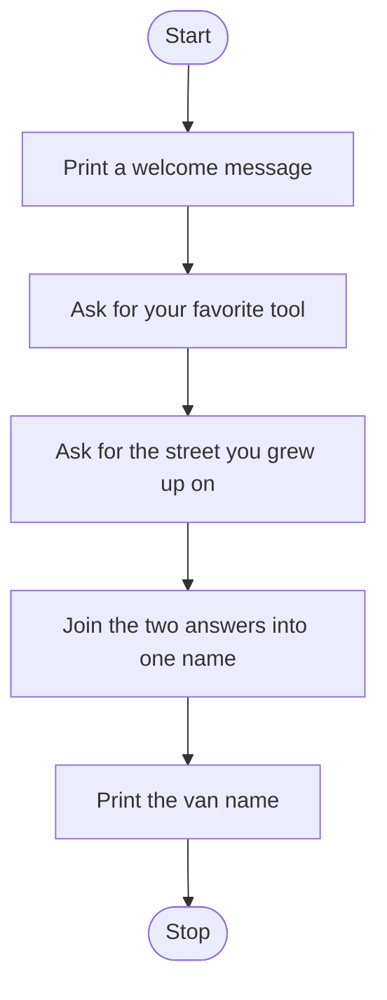

# Van Name Generator Roadmap

Follow the stages in order. Finish and test one stage before you start the next, and only build what that stage asks for.

## The big picture

**One stage at a time:** write a stage, run it, and make sure it works before you touch the next one. If something breaks, it is almost always in the stage you just wrote.

## Stage 1: Say hello
1. **Print a welcome.** Which function shows text on the screen?
2. **Watch the quotes.** What happens if you forget the closing quote?

Test it: run it. Does your welcome line show up exactly as you typed it?

## Stage 2: Ask the questions
1. **Ask for the tool.** Which function lets the player type an answer?
2. **Keep the answer.** How do you store what they typed so you can use it later? What makes a good variable name?
3. **Ask for the street** the same way.
4. **Put the answer on its own line.** Which special character starts a new line inside a string?

Test it: answer both questions, then print each variable. Do you see exactly what you typed?

## Stage 3: Build the name
1. **Join the answers.** Which symbol sticks two strings together?
2. **Mind the gap.** How do you get a space between the two words?
3. **Store the result** in its own variable.

Test it: type "wrench" and "Main". Is there a space between them?

## Stage 4: Show the name
1. **Print the final name** with a short message in front of it.
2. **Read it out loud.** Does the sentence make sense?

Test it: run it three times with different answers. Does the name change each time?

## Stage 5: Tidy up and break it
1. **Break it on purpose.** What happens if you just press Enter on a question?
2. **Explain it out loud.** Can you say what every line does without peeking?
