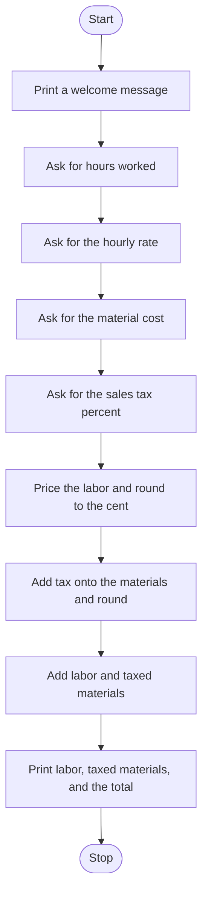

# Plumbing Quote Calculator Roadmap

Follow the stages in order. Finish and test one stage before you start the next, and only build what that stage asks for.

## The big picture

**One stage at a time:** write a stage, run it, and make sure it works before you touch the next one. If something breaks, it is almost always in the stage you just wrote.

## Stage 1: The four numbers
1. **Welcome them** to the quote calculator.
2. **Ask for hours, the hourly rate, the material cost, and the sales tax percent.**
3. **Decimals.** Hours, money, and a tax rate can all have a fraction. Which function turns each answer into a decimal?

Test it: enter one of each and print them. Are they numbers, not text?

## Stage 2: Labor
1. **Price the labor.** Hours times the hourly rate.
2. **Round to the cent** before you go on.

Test it: 2.5 hours at 80 dollars an hour. Is the labor 200?

## Stage 3: Tax on the materials
1. **Turn the tax percent into a multiplier,** the same idea as a tip. How do you get from 8 to 1.08?
2. **Taxed materials** are the material cost times that multiplier, rounded to the cent.

Test it: 100 dollars of materials at 8 percent tax. Do you get 108?

## Stage 4: The quote
1. **The total** is labor plus taxed materials. Round that too.
2. **Print three lines:** labor, materials with tax, and the total cost. Each amount needs a dollar sign.
3. **Keep the trailing zero.** `round` can turn 200.50 into 200.5 when you print it. Which f-string format forces two digits after the decimal?

Test it: 2 hours, 50 dollars an hour, 100 dollars of materials, 10 percent tax. Do you get labor 100.00, materials 110.00, and total 210.00?

## Stage 5: Tidy up and break it
1. **Break it on purpose.** Zero hours? Zero tax? A word instead of a number?
2. **Explain it out loud.** Which number got the tax, and which one did not?
