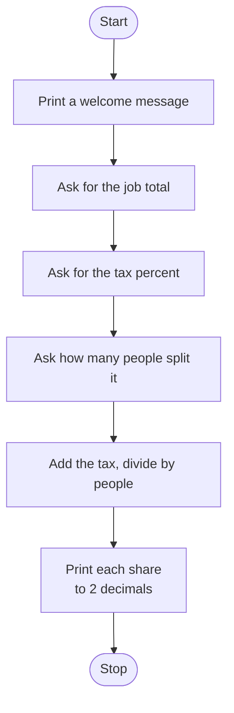

# Job Split Calculator Roadmap

Follow the stages in order. Finish and test one stage before you start the next, and only build what that stage asks for.

## The big picture

**One stage at a time:** write a stage, run it, and make sure it works before you touch the next one. If something breaks, it is almost always in the stage you just wrote.

## Stage 1: Get the numbers
1. **Ask for the job total.** What type does input() give back? Can you do math with that?
2. **Convert it.** Money can have cents. Which type keeps the decimal part?
3. **Ask for the tax percent** and convert it the same way.
4. **Ask how many people.** Can you split a job between 2.5 people? Which type fits a whole number?

Test it: print each variable and its type. Are they the types you expected?

## Stage 2: Add the tax
1. **Percent to a number.** If the tax is 10, what do you divide by to get 0.10?
2. **Total with tax.** How do you add that tax on top of the job total? (Hint: think about multiplying by 1 plus something.)

Test it: a $100 job with 10% tax. Do you get 110?

## Stage 3: Split it
1. **Divide** the total with tax by the number of people. Which symbol divides?
2. **Order of operations.** Do you need brackets anywhere so the math happens in the right order?

Test it: $100 job, 10% tax, 2 people. Do you get 55?

## Stage 4: Show the share
1. **Round it.** Money has 2 decimal places. Which function, or which f-string trick, does that?
2. **Print it** with an f-string and a dollar sign.

Test it: $150, 12% tax, 3 people. Does it show 56.00, with exactly two decimals?

## Stage 5: Tidy up and break it
1. **Break it on purpose.** What happens if you type 0 people? What about letters instead of a number?
2. **Explain it out loud.** Can you say why each input needed the type you picked?
