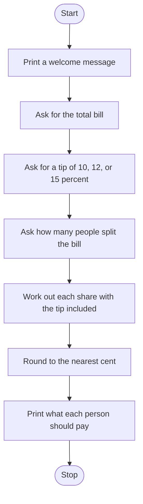

# Tip Calculator Roadmap

Follow the stages in order. Finish and test one stage before you start the next, and only build what that stage asks for.

## The big picture

**One stage at a time:** write a stage, run it, and make sure it works before you touch the next one. If something breaks, it is almost always in the stage you just wrote.

## Stage 1: The bill
1. **Welcome them.**
2. **Ask for the total.** A bill can include cents. Which function turns text into a decimal number?
3. **Store it** in a clearly named variable.

Test it: enter 100.50 and print the variable. Do the cents survive?

## Stage 2: The tip
1. **Ask for 10, 12, or 15.** `input` gives you text. Which function makes that a whole number?
2. **Turn the percent into a multiplier.** A 15 percent tip means each person pays the share times 1.15. How do you get from 15 to 1.15?

Test it: print the multiplier for 10, then 12, then 15. Do you get 1.1, 1.12, and 1.15?

## Stage 3: Split it
1. **Ask how many people.** That answer is a whole number.
2. **Each person's share** is the bill divided by the people, then multiplied by the tip multiplier.
3. **Nearest cent.** Which function rounds to 2 decimal places?

Test it: bill of 100, tip of 10, 2 people. Does each person pay 55?

## Stage 4: Print the share
1. **One sentence** with a dollar sign and the rounded share.
2. **Drop the number into the sentence.** Which kind of string lets you put a variable inside curly braces?

Test it: run the same 100 / 10 / 2 case. Does the sentence read clearly?

## Stage 5: Tidy up and break it
1. **Break it on purpose.** A tip of 0? One person? A word instead of a number?
2. **Trailing zeros.** What does a rounded 5.50 look like when you print it? This program uses `round`, so a trailing zero can disappear.
3. **Explain it out loud.** Can you say what the multiplier is doing without peeking?
