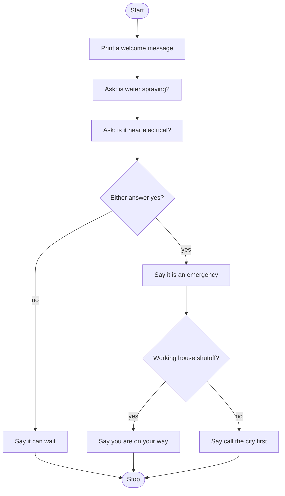

# Leak Triage Bot Roadmap

Follow the stages in order. Finish and test one stage before you start the next, and only build what that stage asks for.

## The big picture

**One stage at a time:** write a stage, run it, and make sure it works before you touch the next one. If something breaks, it is almost always in the stage you just wrote.

## Stage 1: Ask the questions
1. **Ask both yes/no questions** and store the answers.
2. **Capital letters.** What if someone types "Yes" or "YES"? Which string method makes every answer lowercase?

Test it: print both answers. Are they always lowercase?

## Stage 2: One question, one decision
1. **Check one answer.** Which keyword starts a decision? Which symbol checks if two things are equal (not the one that stores a value)?
2. **The other path.** Which keyword handles "anything else"?
3. **Indentation.** How does Python know which lines belong inside the if?

Test it: answer yes, then no. Do you get a different message each time?

## Stage 3: Combine the questions
1. **Either one is enough.** Spraying water OR water near electrical is an emergency. Which logical operator means "either one"?
2. **When would you use the other one?** What does `and` need to be true?

Test it: try all four combos (yes/yes, yes/no, no/yes, no/no). Only no/no should say it can wait.

## Stage 4: The follow-up question
1. **Ask only in an emergency.** Where does the shutoff question go so it is only asked on the emergency path?
2. **Nest the decision.** How far in does the second if need to be indented?

Test it: emergency + shutoff yes, emergency + shutoff no, and no emergency. Is the shutoff question skipped when it is not an emergency?

## Stage 5: Tidy up and break it
1. **Break it on purpose.** What happens if someone types "y" or "maybe"? Which branch does it land in? Is that safe for a leak?
2. **Explain it out loud.** Can you trace every path through the if/else without running it?
