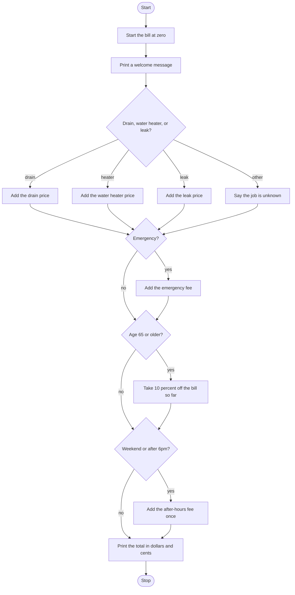

# Service Call Pricer Roadmap

Follow the stages in order. Finish and test one stage before you start the next, and only build what that stage asks for.

## The big picture

**One stage at a time:** write a stage, run it, and make sure it works before you touch the next one. If something breaks, it is almost always in the stage you just wrote.

## Stage 1: Price the job
1. **Start the bill at zero.** Why does it need a starting number before you add anything?
2. **Welcome them, then ask** for `d` (drain), `w` (water heater), or `l` (leak). Make the answer lowercase.
3. **Add the price.** Drain is 150, water heater is 1200, leak is 250.
4. **Anything else** prints that the job is unknown and leaves the bill at zero. The later questions still get asked.

Test it: pick d, then w, then l, and print the bill each time. Then type `x`. Is the bill still 0?

## Stage 2: The emergency fee
1. **Ask whether it is an emergency,** y or n, in lowercase.
2. **Yes adds 100.** A no should skip the fee. Where does that if go?

Test it: a drain with y, then a drain with n. Is the difference exactly 100?

## Stage 3: The senior discount
1. **Ask for the customer's age** and turn it into a whole number.
2. **65 or older.** Which comparison includes 65 itself?
3. **Take 10 percent off the bill so far,** including the emergency fee if there was one. How do you subtract 10 percent of the current bill?

Test it: water heater, not an emergency, age 65. Is the bill 1080? Then age 64. Does it stay 1200?

## Stage 4: After hours, then the total
1. **Ask two questions:** is it the weekend, and is it after 6pm?
2. **Either answer being yes is enough.** Which operator means "or"?
3. **Add 75 once.** Saying yes to both should not add 150.
4. **Print the total** with a dollar sign and two decimal places. Which f-string format keeps both digits?

Test it: leak, not an emergency, age 30, weekend yes, after 6pm no. Is the total 325.00? Run it again with yes to both. Is it still 325.00?

## Stage 5: Tidy up and break it
1. **Check the order.** The emergency fee is added before the discount, and the after-hours fee is added after the discount. What does a senior emergency call pay on a drain?
2. **Break it on purpose.** Age "sixty"? Job letter `D`? A blank answer?
3. **Explain it out loud.** Can you say what the bill is after each question?
