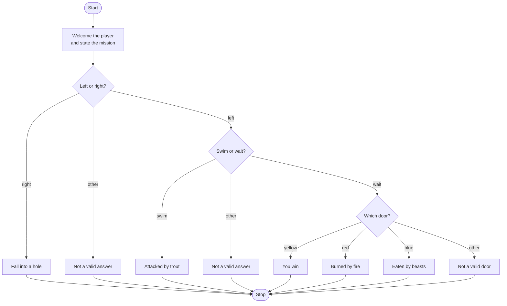

# Treasure Island Roadmap

Follow the stages in order. Finish and test one stage before you start the next, and only build what that stage asks for.

## The big picture

**One stage at a time:** write a stage, run it, and make sure it works before you touch the next one. If something breaks, it is almost always in the stage you just wrote.

## Stage 1: The welcome
1. **Two lines.** Welcome the player to Treasure Island, then tell them the mission is to find the treasure.

Test it: run it. Do both lines show before any question?

## Stage 2: Left or right
1. **Ask left or right** and store the answer.
2. **Ignore capitals.** Which string method makes "Left" and "left" the same?
3. **Only left continues.** Right falls into a hole. Any other answer is not valid.
4. **The next question belongs inside the left branch.** How does indentation tell Python that?

Test it: try left, right, and "up". Does only left keep the game going?

## Stage 3: Swim or wait
1. **Ask swim or wait** only after a left turn.
2. **Only waiting continues.** Swimming ends with the trout. Any other answer is not valid.
3. **Nest this decision** inside the left branch. How far in does it need to be indented?

Test it: left then swim, left then wait, and left then "fly". Does only wait reach another question?

## Stage 4: The three doors
1. **Ask which door:** yellow, blue, or red.
2. **Yellow wins.** Red burns. Blue gets eaten by beasts.
3. **Any other door** is not valid. Where does that `else` sit so it does not also run after a win?
4. **One chain.** Use if / elif / else so a single door prints a single ending.

Test it: reach the doors and try yellow, red, blue, and "green". Do you get one win and three different game-over lines?

## Stage 5: Tidy up and break it
1. **Break it on purpose.** "LEFT", a blank line, or "wait" with a space in front. Which of those still works, and why?
2. **Explain it out loud.** Can you trace every path to its ending without running it?
