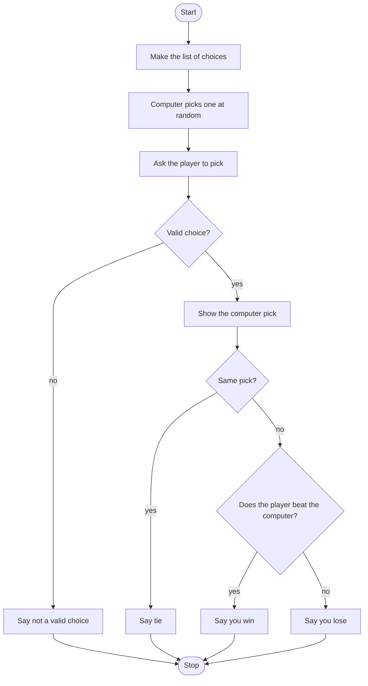

# Fitting Rock Paper Scissors Roadmap

Follow the stages in order. Finish and test one stage before you start the next, and only build what that stage asks for.

## The big picture

**One stage at a time:** write a stage, run it, and make sure it works before you touch the next one. If something breaks, it is almost always in the stage you just wrote.

## Stage 1: The choices
1. **Write down the rules.** Wrench beats pipe, pipe beats plunger, plunger beats wrench.
2. **Make a list.** How do you store all three choices in one variable?
3. **Indexes.** What index is the first item? What about the last?

Test it: print the list, then print just the second item. Is it the one you expected?

## Stage 2: The computer picks
1. **Import the tool.** Which module does random things?
2. **Pick one.** Which function picks a random item from a list? Or could you pick a random index instead?

Test it: run it five times and print the pick. Does it change?

## Stage 3: The player picks
1. **Ask for a choice** and make it lowercase.
2. **Is it real?** How can you check if what they typed is in your list?

Test it: type "WRENCH" and then "hammer". Is the first accepted and the second rejected?

## Stage 4: Who wins?
1. **The tie first.** How do you check if both picks are the same?
2. **The winning combos.** How many ways can the player win? Which operator joins "computer picked this" with "player picked that"?
3. **Everything else.** If it is not a tie and not a win, what is left?

Test it: peek at the computer pick, then try a win, a loss and a tie on purpose. Are all three right?

## Stage 5: Tidy up and break it
1. **Show both picks** before the result, so the player can see why.
2. **Break it on purpose.** Blank answer? Extra spaces? What happens?
3. **Explain it out loud.** Can you say why each elif is there?
