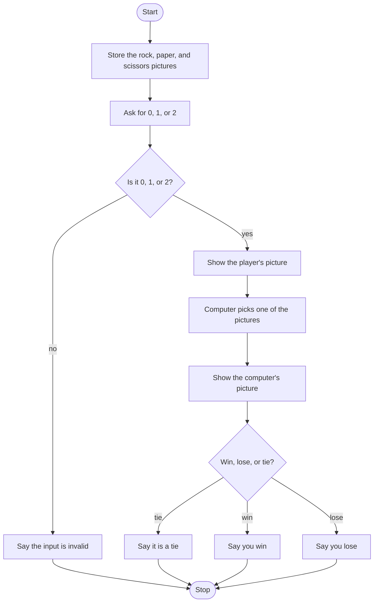

# Rock Paper Scissors Roadmap

Follow the stages in order. Finish and test one stage before you start the next, and only build what that stage asks for.

## The big picture

**One stage at a time:** write a stage, run it, and make sure it works before you touch the next one. If something breaks, it is almost always in the stage you just wrote.

## Stage 1: The pictures
1. **Three pictures.** How do you write a string that spans several lines?
2. **Name them** rock, paper, and scissors.
3. **Put the three pictures in a list** so the computer can pick from it later. What is the index of the first one?

Test it: print each picture. Do they look like rock, paper, and scissors?

## Stage 2: The player's choice
1. **Ask for 0, 1, or 2.** `input` gives you text. Will you compare it to the number 0 or to the text `"0"`?
2. **Show the matching picture.** 0 is rock, 1 is paper, 2 is scissors.

Test it: type 0, then 1, then 2. Does the matching picture show each time?

## Stage 3: The computer, and bad input
1. **Import the random module.**
2. **Only play if the answer was 0, 1, or 2.** Anything else prints that the input is invalid and skips the computer.
3. **Pick one picture** from the list. Which function returns one item?
4. **Print a short line** that the computer chose, then the picture.

Test it: type 5. Do you get the invalid line and no computer picture? Type 1 a few times. Does the computer's picture change?

## Stage 4: Who wins
1. **The rules.** Rock beats scissors, scissors beat paper, paper beats rock. The same picture is a tie.
2. **You are comparing the player's text with the computer's picture.** How do you say "player typed 0 and the computer picked the rock picture"? Which operator means both sides must be true?
3. **Cover every pair.** Three player choices, three pictures each: a tie, a win, and a loss.
4. **Print** a win, a loss, or a tie.

Test it: temporarily set the computer's picture yourself and try one win, one loss, and one tie for 0, for 1, and for 2. Take that temporary line out when they all match the rules.

## Stage 5: Tidy up and break it
1. **Break it on purpose.** 3, -1, the word "rock", a blank line, or `0` with a space after it.
2. **Explain it out loud.** Why does an invalid choice never reach the win check?
