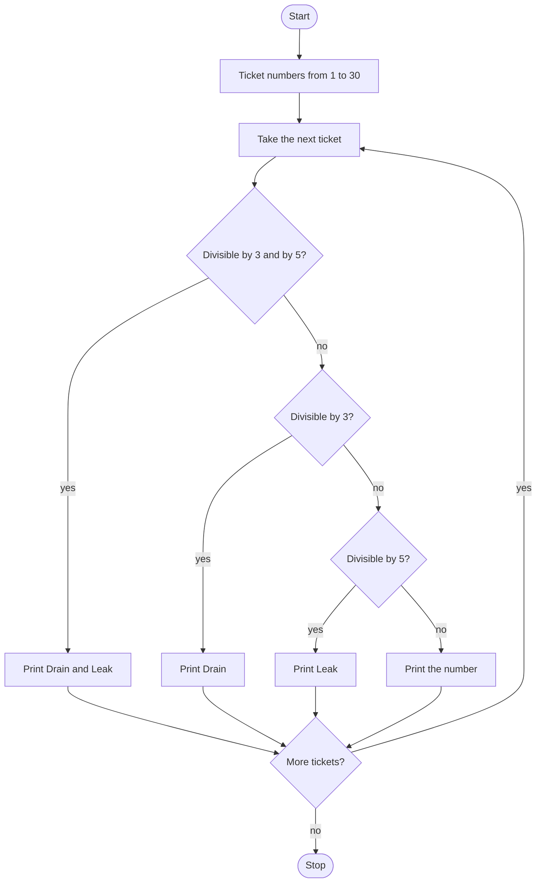

# Drain & Leak Roadmap

Follow the stages in order. Finish and test one stage before you start the next, and only build what that stage asks for.

## The big picture

**One stage at a time:** write a stage, run it, and make sure it works before you touch the next one. If something breaks, it is almost always in the stage you just wrote.

## Stage 1: The tickets
1. **The tickets are the numbers 1 through 30,** stored in a list.
2. **Visit each number.** Which loop does that?

Test it: print every ticket. Do you see 1 through 30, and not 0 or 31?

## Stage 2: Drain & Leak
1. **Divisible.** Which operator gives you the remainder? A remainder of 0 means it divides evenly.
2. **Both 3 and 5.** Which logical operator means both tests are true?
3. **Print `Drain & Leak` for those tickets,** and nothing else for that same number.
4. **This check has to come first.** 15 is divisible by 3 and by 5. What would print if the "divisible by 3" check came first?

Test it: which tickets should say Drain & Leak? Check 15 and 30 by hand against the output.

## Stage 3: Drain, Leak, or the number
1. **Multiples of 3** print `Drain`. Use elif so a Drain & Leak ticket does not also print Drain.
2. **Multiples of 5** print `Leak`.
3. **Every other ticket** prints the number itself.

Test it: 3 prints Drain, 5 prints Leak, 15 prints only Drain & Leak, and 1 prints 1. Walk the whole list once and mark any miss.

## Stage 4: Tidy up and break it
1. **Swap the order in your head.** If the divisible-by-3 check came before the "both" check, what would 15 print?
2. **Explain it out loud.** What does the remainder operator tell you, and why is there an else?
