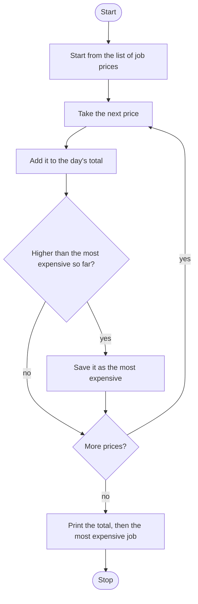

# Job Price Totaler Roadmap

Follow the stages in order. Finish and test one stage before you start the next, and only build what that stage asks for.

## The big picture

**One stage at a time:** write a stage, run it, and make sure it works before you touch the next one. If something breaks, it is almost always in the stage you just wrote.

## Stage 1: Add them up
1. **The prices are already in a list.**
2. **Start the day's total at 0.** Why 0, and not the first price?
3. **Add each price in one loop.** Which operator adds onto a variable you already have?

Test it: add the list by hand, then run the program. Do the totals match?

## Stage 2: Keep the highest
1. **Start "most expensive so far" at 0.** For this list, why is 0 low enough that the first real price replaces it?
2. **Use the same loop.** If this price is greater than the one you have saved, replace it. You do not need a second pass.
3. **Greater than, not greater than or equal.** What happens on a tie with the price you already saved?

Test it: what is the biggest number in the list? Does the program land on that one?

## Stage 3: Print both, after the loop
1. **Print the day's total, then the most expensive job.**
2. **Those prints go after the loop.** What would you see if they were inside it?

Test it: run it twice. Two lines, and they do not change. Why not?

## Stage 4: Tidy up and break it
1. **Explain it out loud.** What is an accumulator, and which two variables are yours?
2. **One pass.** Can you point at the single loop and say where the total grows and where the highest is replaced?
