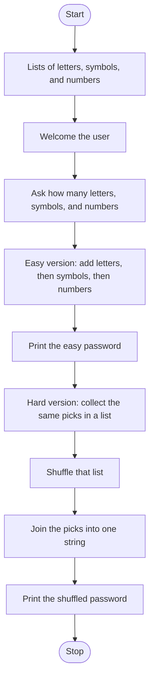

# Password Generator Roadmap

Follow the stages in order. Finish and test one stage before you start the next, and only build what that stage asks for.

## The big picture

**One stage at a time:** write a stage, run it, and make sure it works before you touch the next one. If something breaks, it is almost always in the stage you just wrote.

## Stage 1: The pools
1. **Three lists:** letters, symbols, and numbers. Include both lowercase and uppercase letters.
2. **Store the digits as text.** What goes wrong later if a list item is the number 4 instead of the character `"4"`?
3. **Import random.**

Test it: print one random item from each list. Does it change when you run it again?

## Stage 2: Ask how many
1. **Welcome them** to the password generator.
2. **Ask for three counts:** letters, then symbols, then numbers. Which function turns each answer into a whole number?

Test it: print the three counts. Are they numbers?

## Stage 3: Easy version
1. **Start with an empty string.**
2. **Three loops, in this order:** that many letters, then that many symbols, then that many numbers. Which loop runs a set number of times, and which function picks one item from a list?
3. **Add each pick onto the string.** Which operator does that?
4. **Print the password.**

Test it: ask for 4 letters, 2 symbols, and 2 numbers. Is the result 8 characters, with the letters first?

## Stage 4: Hard version
1. **Start a new list,** separate from the easy string. Which list method adds one pick to the end?
2. **Use the same three counts** and the same three pools.
3. **Shuffle the list.** Which random function mixes it in place?
4. **Join it back** into one string with a loop, then print that second password.
5. **Both versions run every time.** The easy password prints first, then the shuffled one. Do not replace the easy print.

Test it: use the same counts a few times. Is the second password the same length, in a different order?

## Stage 5: Tidy up and break it
1. **Break it on purpose.** Zero of everything? A word? A negative number?
2. **Explain it out loud.** What is the difference between adding onto a string and appending to a list?
