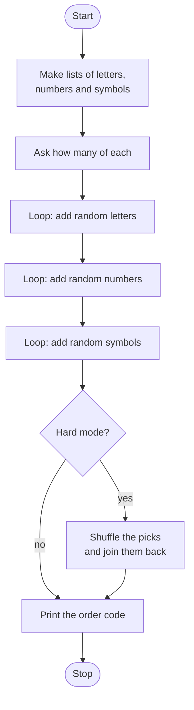

# Parts Order Builder Roadmap

Follow the stages in order. Finish and test one stage before you start the next, and only build what that stage asks for.

## The big picture

**One stage at a time:** write a stage, run it, and make sure it works before you touch the next one. If something breaks, it is almost always in the stage you just wrote.

## Stage 1: The pieces
1. **Make three lists:** letters, numbers and symbols. Should the numbers be stored as numbers or as text? Why does it matter when you join them?
2. **Import the tool** that picks random items.

Test it: print one random item from each list. Does it change each run?

## Stage 2: Ask how many
1. **Ask for three counts.** Which type do you need to repeat something that many times?

Test it: print the three counts. Are they whole numbers?

## Stage 3: Build the code (easy mode)
1. **Start empty.** What do you set the code to before the loop?
2. **Repeat a set number of times.** Which loop and which function give you "do this N times"?
3. **Add a pick each time.** Which operator adds onto the end of what you already have?
4. **Do it three times**, once per list.

Test it: ask for 2, 3, 1. Is the code 6 characters long, letters first, then numbers, then symbols?

## Stage 4: Mix it up (hard mode)
1. **Store picks in a list instead.** Which list method adds an item to the end?
2. **Shuffle.** Which function in the random module mixes a list?
3. **Back to text.** How can a for loop go through the list and build one string?

Test it: run it a few times with the same counts. Is the order different each time, but the length the same?

## Stage 5: Tidy up and break it
1. **Break it on purpose.** What happens with 0 of everything? What about a negative number?
2. **Explain it out loud.** What is an accumulator, and where are yours?
