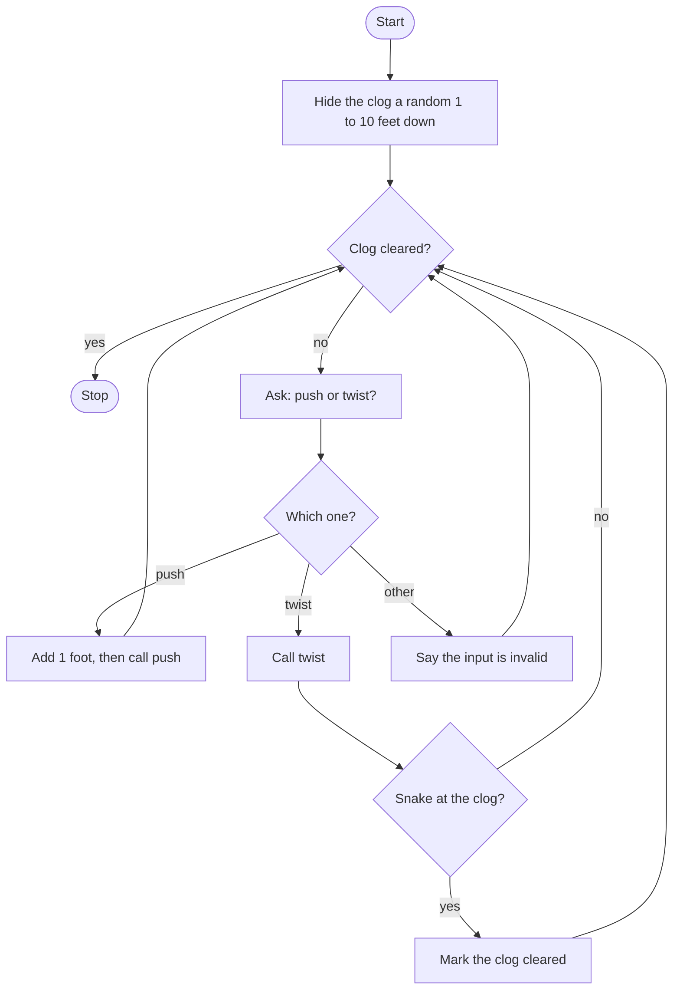

# Drain Snake Simulator Rebuild Roadmap

Follow the stages in order. Finish and test one stage before you start the next, and only build what that stage asks for.

## The big picture

**One stage at a time:** write a stage, run it, and make sure it works before you touch the next one. If something breaks, it is almost always in the stage you just wrote.

## Stage 1: Hide the clog
1. **Pick a distance** from 1 to 10. Which random function gives a whole number between two values, and is the top value included?
2. **Start the snake at 0.**
3. **A True/False flag** starts out not cleared. What do you name it so the loop can read it?

Test it: print the clog distance a few times. Is it always from 1 to 10?

## Stage 2: push and twist
1. **`push` only prints the snake's position.** It does not add 1. The caller does that. Why keep those as two steps?
2. **`twist` checks the position against the clog.** At the clog it says the drain is cleared. Anywhere else it says to keep pushing.
3. **`twist` does not flip the cleared flag.** Printing the message and stopping the loop are different jobs. Who stops the loop?
4. **Give each function a docstring.**

Test it: set the position by hand, call `push`, then call `twist` once on the clog and once short of it. Do you get the two different messages?

## Stage 3: One flat loop
1. **Welcome them,** then loop while the clog is not cleared.
2. **Ask "Push or Twist?"** and make the answer lowercase.
3. **One if / elif / else, with no nested if in the main loop.** Push adds 1 and then calls `push`. Twist calls `twist`, and only then, if the position matches the clog, sets the flag. Anything else says the input is invalid.

Test it: peek at the distance, push until the printed position matches, then twist. Start over and twist on the first turn. Does the early twist keep the loop going?

## Stage 4: Tidy up and break it
1. **Push past the clog, then twist.** What prints, and does the loop end?
2. **A capital P, a blank line, the word "shove".** Which branch runs?
3. **Explain it out loud.** What does `twist` decide, and what does the loop decide after it returns?
