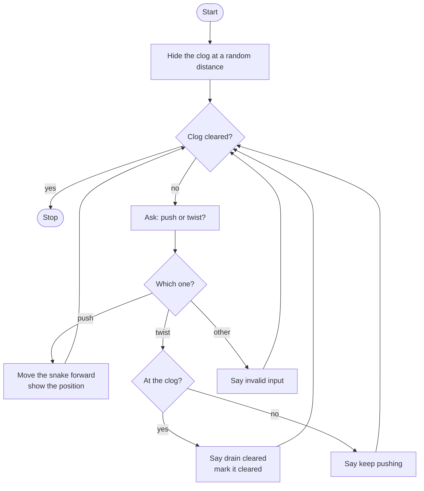

# Drain Snake Simulator Roadmap

Follow the stages in order. Finish and test one stage before you start the next, and only build what that stage asks for.

## The big picture

**One stage at a time:** write a stage, run it, and make sure it works before you touch the next one. If something breaks, it is almost always in the stage you just wrote.

## Stage 1: Hide the clog
1. **Pick a distance.** Which random function gives a whole number between two values?
2. **Track the snake.** What number should the snake position start at?
3. **Track the job.** What kind of value (True/False) tells you if the clog is cleared?

Test it: print the clog distance a few times. Is it always in your range?

## Stage 2: Write the functions
1. **Define push().** Which keyword creates a function? What should it print?
2. **Define twist().** What should happen when you twist in the right spot?
3. **Call them.** Defining a function does not run it. How do you run it?

Test it: call each function once by itself. Do they print what you expect?

## Stage 3: Keep going until it is clear
1. **Pick the loop.** Which loop keeps going while something is still true?
2. **The stop switch.** Which variable does the loop check? What makes the loop stop?
3. **Ask each time:** push or twist?

Test it: for now, make any answer clear the clog. Does the loop end?

## Stage 4: Push and twist
1. **Push.** How do you add 1 to the snake position each time?
2. **Twist.** How do you check if the snake is at the clog? What should happen if it is not there yet?
3. **Anything else.** What does the player see if they type a typo?

Test it: peek at the clog distance, push to it and twist. Then twist too early. Do both work?

## Stage 5: Tidy up and break it
1. **Infinite loop check.** What happens if you never set the cleared variable to True? Make sure there is a way out.
2. **Pushed too far?** What happens if you push past the clog? Should you warn the player?
3. **Explain it out loud.** Can you say what every function does and when it is called?
