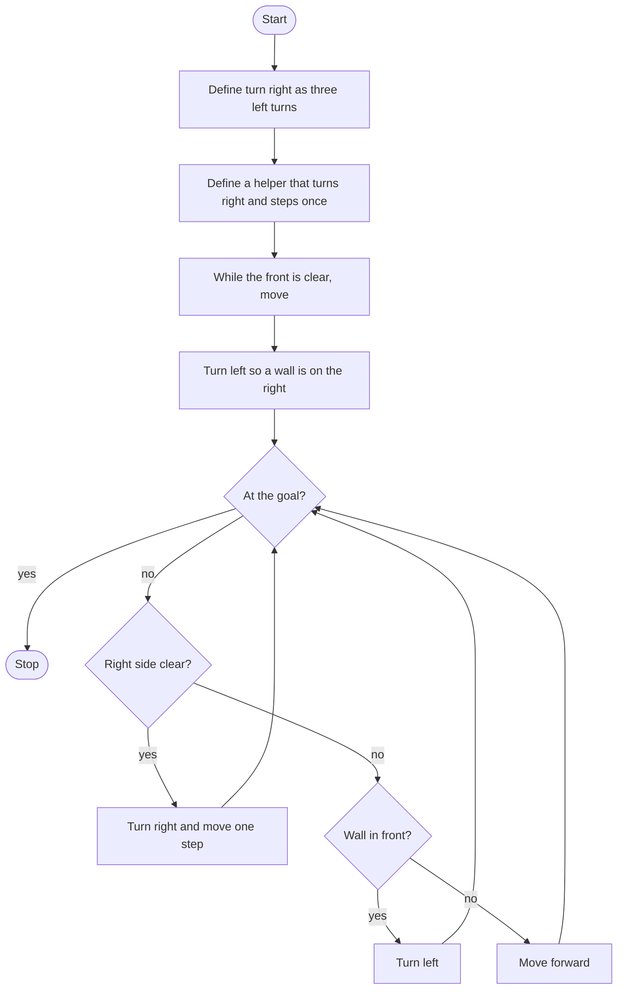

# Reeborg's Maze Roadmap

Follow the stages in order. Finish and test one stage before you start the next, and only build what that stage asks for.

This program runs in Reeborg's World. That world already gives you `move`, `turn_left`, `front_is_clear`, `right_is_clear`, `wall_in_front`, and `at_goal`. It does not give you `turn_right`.

## The big picture

**One stage at a time:** write a stage, run it, and make sure it works before you touch the next one. If something breaks, it is almost always in the stage you just wrote.

## Stage 1: Turn right
1. **There is no turn_right.** How can three left turns face Reeborg to the right?
2. **Make it a function** and give it a docstring. Defining a function does not turn him. How do you run it?

Test it: in Reeborg's World, call that function once from an open square. Does he end up facing right?

## Stage 2: Turn right and step
1. **A second function** turns right and then moves one square.
2. **Call the function from Stage 1.** Do not copy the three left turns into this one. Why is one call better?

Test it: call the helper once. Did he turn right and move exactly one square?

## Stage 3: Put a wall on his right
1. **Do this before the maze loop.** If the start is open, "the right is clear" is always true, and following it traces a small square forever.
2. **Walk straight** while the front is clear.
3. **Then turn left.** The wall he just reached is now on his right.

Test it: start him in an open area and stop after this stage. Is he standing against a wall, with that wall on his right?

## Stage 4: Follow the right hand
1. **Repeat until he reaches the goal.** Which check does Reeborg's World give you for that?
2. **If the right side is clear,** use the helper from Stage 2.
3. **Otherwise, if a wall is in front,** turn left.
4. **Otherwise,** move forward.
5. **One "right is clear" check is enough.** The wall-in-front branch only runs when the right was blocked. You do not need a second right-side branch.

Test it: run a few random mazes, including an open start. Does he reach the goal without spinning in a square?

## Stage 5: Tidy up and break it
1. **Plain Python cannot run this file.** `turn_left` is not a Python builtin. Where do you paste it instead?
2. **Explain it out loud.** Why does the walk-to-a-wall step have to finish before the main loop starts?
