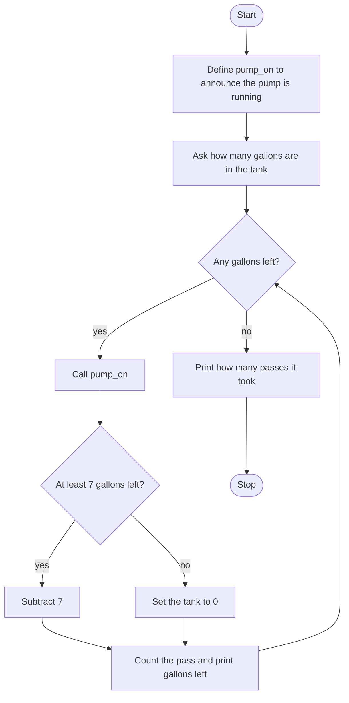

# Tank Drain Simulator Roadmap

Follow the stages in order. Finish and test one stage before you start the next, and only build what that stage asks for.

## The big picture

**One stage at a time:** write a stage, run it, and make sure it works before you touch the next one. If something breaks, it is almost always in the stage you just wrote.

## Stage 1: The pump
1. **Define `pump_on`.** It prints that the pump is running.
2. **Add a docstring** that says what the function is for.
3. **Defining it does not run it.** Call it once to prove the message shows. You can remove that test call after.

Test it: does the announcement show exactly once?

## Stage 2: Ask for the gallons
1. **Ask how many gallons are in the tank.**
2. **A whole number.** Which function turns the answer into one?

Test it: enter 10 and print it back. Is it a number?

## Stage 3: Drain up to 7 gallons a pass
1. **Keep going while any gallons are left.** Which loop fits "while this is still true"?
2. **Each pass starts by calling `pump_on`.**
3. **Remove 7 gallons** when the tank has at least 7. When it has fewer, set it to 0 instead of subtracting. Why would subtracting send the tank negative?
4. **Count the passes.** Start at 0 and add 1 each time through the loop.
5. **Print the gallons left** at the end of the pass.

Test it: 10 gallons. The first pass should leave 3, and the second should leave 0. Try 7, then try 0. Does 0 skip the loop?

## Stage 4: How many passes
1. **After the loop,** print how many passes it took.
2. **The gallons line stays inside the loop. The pass total does not.** What would you see if the pass total printed on every pass?

Test it: 15 gallons. Count the passes by hand. Does the last line agree?

## Stage 5: Tidy up and break it
1. **Break it on purpose.** A word? A negative number? What does the pass line say when the loop never runs?
2. **Explain it out loud.** Why does the under-7 branch set the tank to 0 instead of subtracting?
