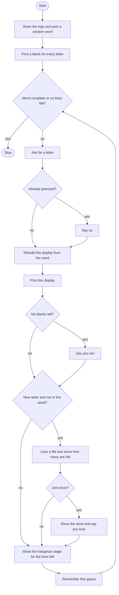

# Hangman Roadmap

Follow the stages in order. Finish and test one stage before you start the next, and only build what that stage asks for.

The word list is already in `hangman_words.py`. The logo and the stage pictures are already in `hangman_art.py`. This program imports them. It does not build the pictures itself.

## The big picture

**One stage at a time:** write a stage, run it, and make sure it works before you touch the next one. If something breaks, it is almost always in the stage you just wrote.

## Stage 1: Logo, word, blanks
1. **Import the word list, the logo, and the stages,** plus the random module.
2. **Start with 6 lives** and show the logo.
3. **Pick one word** from the list.
4. **Print one underscore per letter.** A separate placeholder string is what shows before the first guess. How do you add one underscore for each letter in the word?

Test it: peek at the word. Does the blank line have the same number of underscores?

## Stage 2: Rebuild the display for one guess
1. **Ask for a letter** and make it lowercase.
2. **Start the display as an empty string on every guess,** then fill it again. What goes wrong if you add onto last turn's display instead?
3. **Walk the word.** If this letter matches the guess, add the letter and remember it as a correct letter. If it is a letter you already found earlier, add that letter. Otherwise add an underscore.
4. **Print the display.**

Test it: guess a letter that appears twice. Do both spots fill in, and do the other spots stay blank?

## Stage 3: Loop until a win
1. **You need a display variable before the loop,** so the condition can be checked the first time. An empty string is enough to enter.
2. **Keep asking** while the display is not the whole word and lives are still above 0. Which loop?
3. **If the display has no underscore left,** say they win.

Test it: guess every letter in the word. Does it stop after the win line, instead of asking again?

## Stage 4: A new miss costs a life
1. **A new miss** is a guess that is not in the word and is not already in the guessed list. Take one life away.
2. **Say which letter missed,** and print how many lives are left out of 6.
3. **At 0 lives,** print the word and say they lose.
4. **Then show the stage picture** for the current life count. The stages list is ordered so index 0 is the fully drawn figure. Which index is 6 lives?
5. **Remember the guess after the miss check,** not before. Why does the order matter?

Test it: miss with letters that are not in the word until you lose. Do the pictures get more complete, and does the word show at 0?

## Stage 5: A repeat is not a new miss
1. **If the letter is already in the guessed list,** say they already guessed it.
2. **Do not take another life.** The miss check has to see the old list. When do you append this guess?

Test it: miss with `z`, then guess `z` again. Does the life count stay the same the second time? Then guess a correct letter twice. Does the second time avoid a penalty too?

## Stage 6: Tidy up and break it
1. **Break it on purpose.** Two letters, a digit, a capital letter, or a blank line.
2. **Explain it out loud.** Why is the display rebuilt from the word on every guess, and why do correct letters have to be stored?
