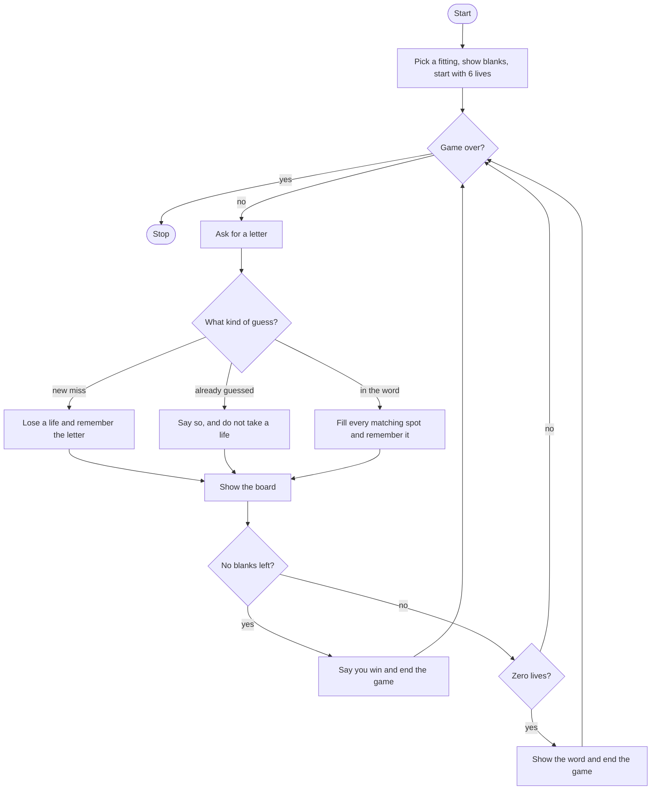

# Guess the Fitting Rebuild Roadmap

Follow the stages in order. Finish and test one stage before you start the next, and only build what that stage asks for.

## The big picture

**One stage at a time:** write a stage, run it, and make sure it works before you touch the next one. If something breaks, it is almost always in the stage you just wrote.

## Stage 1: The board
1. **A short list of fitting names,** then pick one at random.
2. **Six lives,** a game-over flag that starts false, and an empty list for letters already guessed.
3. **Welcome them.**
4. **One blank per letter,** stored in a list. Why is a list easier to change in one spot than a string?
5. **Print the blanks.**

Test it: peek at the word. Does the blank count match its length?

## Stage 2: Fill a correct letter
1. **Ask for one letter** and make it lowercase.
2. **Check every position,** not just whether the letter appears once. Which function gives you the length, and which one gives you the positions?
3. **Replace the blank** at each matching position.

Test it: choose a word with a repeated letter, or temporarily use one. Does one guess fill every copy?

## Stage 3: Win or lose
1. **Loop while the game is not over.**
2. **No blanks left** means they win. Set the flag and say so.
3. **Zero lives** means they lose. Set the flag, and show the word.

Test it: with the word showing, spell it. Then start over and miss six times. Do both endings stop the questions?

## Stage 4: Do not charge a repeat
1. **Three branches, in this order.** A letter that is not in the word and not yet guessed loses a life, prints the lives left and the board, and is stored. A letter already in the guessed list prints a message and the board, and does not lose a life. Anything else is in the word: fill it, store it, and print the board.
2. **Store the letter at the end of the branch,** after you have decided whether it is new. What happens on the first guess if you store it first?

Test it: guess a wrong letter, then the same letter again. Does the life count drop only once? Guess a correct letter twice. Does the second time print the already-guessed message?

## Stage 5: Tidy up and break it
1. **Break it on purpose.** Two letters, a digit, or a blank line. A repeat of those should not take a second life either.
2. **Explain it out loud.** Which branch fills letters, which branch spends a life, and which branch only talks?
