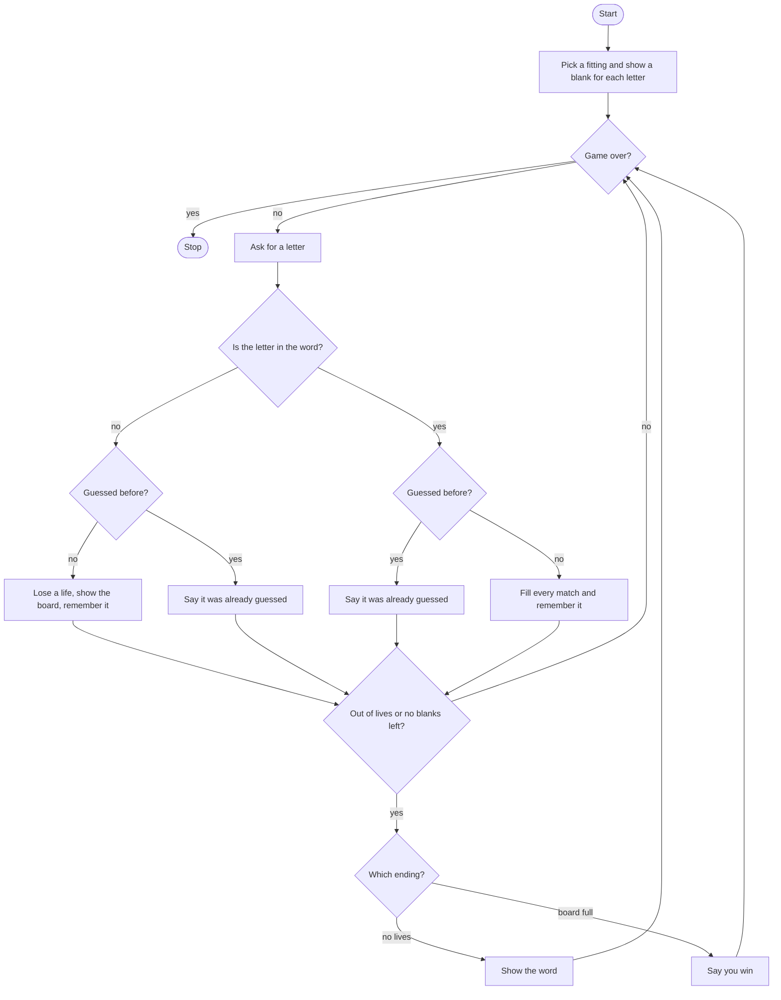

# Guess the Fitting Second Rebuild Roadmap

Follow the stages in order. Finish and test one stage before you start the next, and only build what that stage asks for.

## The big picture

**One stage at a time:** write a stage, run it, and make sure it works before you touch the next one. If something breaks, it is almost always in the stage you just wrote.

## Stage 1: Pick the word and the blanks
1. **A list of fittings,** one chosen at random.
2. **Six lives,** a game-over flag, and an empty list of letters already tried.
3. **Welcome them.**
4. **Append one underscore per letter** into a list, then print it.

Test it: is the number of blanks the length of the word?

## Stage 2: Keep guessing
1. **Loop while the game is not over.**
2. **Ask for a letter** and make it lowercase.
3. **Stop the loop** when lives hit 0 or the board has no underscore left. Put that check at the end of the turn so a winning guess and a last-life miss both get to finish the turn.

Test it: for now, end the game on any guess. Does the loop stop after one question? Then put the real ending check back.

## Stage 3: A miss, and a repeat miss
1. **First, is the letter missing from the word?**
2. **If it is also new,** take a life, say how many are left, print the board, and remember the letter.
3. **If that miss was already tried,** say so and print the board. Do not take another life.

Test it: guess `z` twice. Is the second line the already-guessed message, with the same life count?

## Stage 4: A hit, and a repeat hit
1. **The letter is in the word, but it was already guessed.** Say so and print the board. Do not fill it again.
2. **A new hit** walks every position and replaces each matching blank. Remember the letter as you find it, then print the board.
3. **After the turn,** if lives are 0, show the word and say they lost. If the board is full, say they win. A full board should not also print the loss.

Test it: fill the word, including a letter that appears twice. Does one guess fill both spots? Then miss six new letters. Does the loss show the word and skip the win line?

## Stage 5: Tidy up and break it
1. **Break it on purpose.** A capital letter, two letters, or a blank line.
2. **Explain it out loud.** Why is "already guessed" checked in two places, once for a miss and once for a hit?
