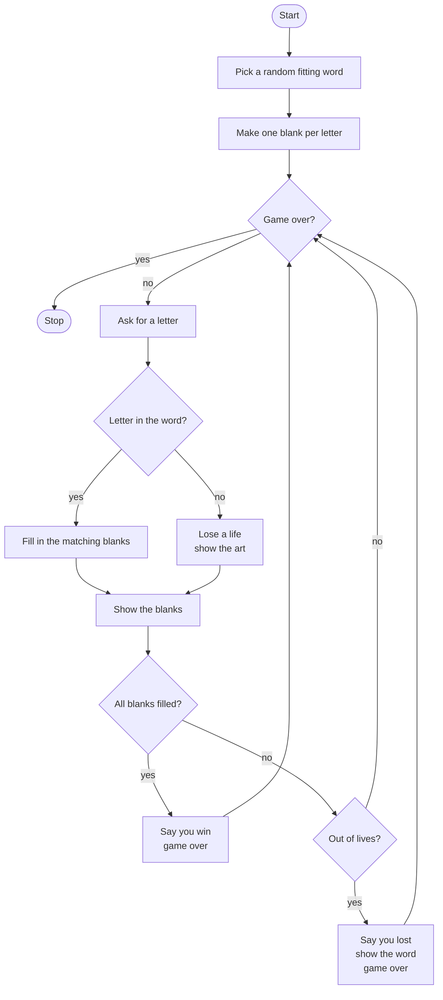

# Guess the Fitting Roadmap

Follow the stages in order. Finish and test one stage before you start the next, and only build what that stage asks for.

## The big picture

**One stage at a time:** write a stage, run it, and make sure it works before you touch the next one. If something breaks, it is almost always in the stage you just wrote.

## Stage 1: Pick the word
1. **Make a word list** of fitting names. Which data type holds many words?
2. **Pick one at random.**
3. **Peek while building.** Print the word for now so you can test.

Test it: run it a few times. Does the word change?

## Stage 2: Make the blanks
1. **One blank per letter.** Which loop goes through every letter in a word?
2. **Store the blanks.** Why is a list better than a string here? (Think about changing one spot later.)

Test it: is the number of blanks the same as the word length?

## Stage 3: One guess
1. **Ask for a letter** and make it lowercase.
2. **Check every position.** How can you loop over positions, not just letters? Which functions give you the length and a range of positions?
3. **Fill in the blank** at each matching position.

Test it: pick a word with a repeated letter. Does guessing it fill in every spot?

## Stage 4: Keep guessing
1. **Pick the loop.** Which loop repeats until the game is over? Which variable controls it?
2. **Win check.** How do you know if any blanks are left?

Test it: guess the whole word. Does the game end with a win?

## Stage 5: Lives
1. **Start with lives.** How many? 
2. **Wrong guess.** How do you check if the letter is NOT in the word? Take a life away.
3. **Lose check.** What number of lives means game over? Show the word when they lose.

Test it: guess wrong until you run out. Does it end at exactly zero?

## Stage 6: Art and polish
1. **Your own ASCII art.** Store a picture for each number of lives in a list. Which index matches which lives count?
2. **Split it up.** Can you move the word list and the art into their own files and import them?
3. **Repeat guesses.** What should happen if the player guesses the same letter twice?

Test it: play a full game win and a full game loss. Does the art change after every wrong guess?

## Stage 7: Tidy up and break it
1. **Break it on purpose.** Type two letters, a number, or nothing. What happens?
2. **Explain it out loud.** Can you trace one full guess through your loops without peeking?
