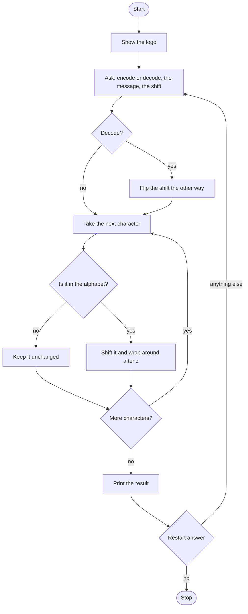

# Caesar Cipher Roadmap

Follow the stages in order. Finish and test one stage before you start the next, and only build what that stage asks for.

The logo is already in `art.py`. This program prints it once, before it asks anything.

## The big picture

**One stage at a time:** write a stage, run it, and make sure it works before you touch the next one. If something breaks, it is almost always in the stage you just wrote.

## Stage 1: The alphabet
1. **Show the logo** by importing it from `art.py`.
2. **Store the lowercase alphabet** in a list.
3. **Find a letter.** Which list method tells you where an item sits?

Test it: print the position of `a` and of `z`. Are they the two ends of the list?

## Stage 2: Shift one letter
1. **Move forward** by adding the shift to the position, then take the letter at the new spot.
2. **Wrap around.** Shifting `z` by 1 has to land on `a`. Which operator gives the remainder so the position stays inside the list?

Test it: shift `a` by 3, then `z` by 1. Do you get `d` and `a`?

## Stage 3: One function for the whole message
1. **Define `caesar`.** It needs the original text, the shift, and whether to encode or decode. Name those parameters, and add a docstring.
2. **Build a new string** one character at a time.
3. **Leave spaces, digits, and symbols unchanged.** How do you test that a character is not in the alphabet?
4. **Print the result** with a short line that names the direction, encode or decode.

Test it: encode `fix the sink!` by 5. Do the space and the exclamation point stay put?

## Stage 4: Decode
1. **Decoding is the same shift in the other direction.** If the direction is decode, flip the sign of the shift once, before the letter loop. What happens to each letter if you flip the sign inside the loop instead?
2. **Call it with keyword arguments,** naming the text, the shift, and the direction at the call. Does the order of those names still have to match the parameter order?

Test it: encode a message, then decode the result with the same shift. Do you get the original back?

## Stage 5: Run it again
1. **A flag starts true,** and a loop keeps going while it is true.
2. **Each pass asks** for the direction, the message, and the shift. Make the direction and the message lowercase. Which answer has to become a whole number?
3. **Then ask** whether to go again. Only `no` sets the flag false. `yes` sets it true, and any other answer leaves it true, so the questions come back. Read the prompt carefully: `no` is the answer that stops.

Test it: encode, say yes, decode, say no. Does it stop? Then start again and answer the restart question with `maybe`. Does it ask for another message?

## Stage 6: Tidy up and break it
1. **Break it on purpose.** A shift of 100? A message that is only spaces? The word `encrypt` as the direction? This program does not reject a bad direction. What does it do instead?
2. **Explain it out loud.** Where does the shift get flipped, and why must that happen only once?
