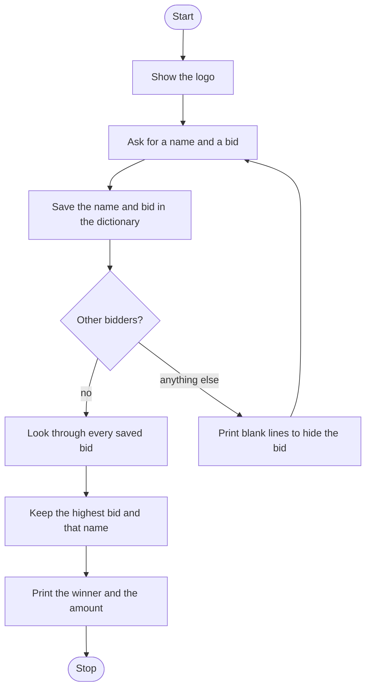

# Blind Auction Roadmap

Follow the stages in order. Finish and test one stage before you start the next, and only build what that stage asks for.

The logo is already in `art.py`. Print it once, before anyone bids.

## The big picture

**One stage at a time:** write a stage, run it, and make sure it works before you touch the next one. If something breaks, it is almost always in the stage you just wrote.

## Stage 1: The bid dictionary
1. **Show the logo.**
2. **An empty dictionary** is the bid board. Which type stores a name together with a number?
3. **A flag starts true** so the bidding loop can run. Name it for "still going", and loop while it is true.

Test it: add one fake bid by hand and print the dictionary. Is the name the key?

## Stage 2: Save every bid
1. **Each pass asks** for the name, then the bid. The bid is a whole number.
2. **Save it immediately,** before you ask if anyone else is bidding. What happens to a bid if you only save it inside one branch?
3. **The key is the name and the value is the bid.** How do you add a new pair?

Test it: enter one bidder and print the dictionary. Then enter a second. Are both still there?

## Stage 3: Another bidder, or stop
1. **Ask if there are any other bidders,** yes or no, and make the answer lowercase.
2. **Only `no` flips the flag** so the loop ends.
3. **Any other answer,** including `yes`, prints a run of blank lines so the next person does not see the last bid. How do you print a newline a set number of times?

Test it: enter two bids and say yes between them. Does the screen clear? Then say no. Do the questions stop?

## Stage 4: The highest bid
1. **After the loop, not inside it.** Find the winner once.
2. **Start the highest bid at 0** and the winner name as an empty string.
3. **Loop the dictionary.** A loop gives you the keys. How do you get the bid stored under a key?
4. **Replace the highest** when this bid is greater, and store that bidder's name at the same time. Compare. Do not add the bids together.
5. **Print the winner and the amount** in one sentence.

Test it: bids of 50, 200, and 75. Does 200 win? Then a single bid of 10. Does that person win?

## Stage 5: Tidy up and break it
1. **Break it on purpose.** `No` with a capital N? Two bidders with the same name? Two bids of the same amount? Which one does a greater-than check keep?
2. **Explain it out loud.** What is the key, what is the value, and why is the winner search outside the bidding loop?
