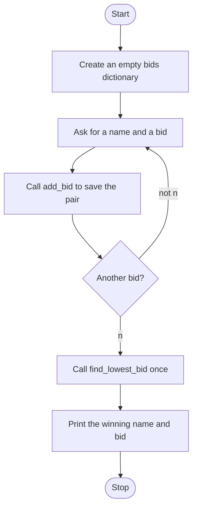

# Contractor Bid Board Updated Roadmap

Follow the stages in order. Finish and test one stage before you start the next, and only build what that stage asks for.

This version finds the lowest bid. The lowest bidder gets the job. It does not clear the screen between bids.

## The big picture

**One stage at a time:** write a stage, run it, and make sure it works before you touch the next one. If something breaks, it is almost always in the stage you just wrote.

## Stage 1: The dictionary
1. **Create the empty dictionary before the loop.** What would you lose if you created a new one on every pass?
2. **Do not put any bids in it yet.**

Test it: print it. Do you see an empty dictionary?

## Stage 2: add_bid
1. **Write `add_bid(bids, name, amount)`** with a docstring. Its only job is to save one bid into the dictionary.
2. **It does not use `input`.** The loop asks the questions and passes the answers in.
3. **The name is the key and the amount is the value.**

Test it: call it with a fake name and amount, then print the dictionary. Is the pair there?

## Stage 3: Collect bids
1. **A flag starts true.** Loop while it is true.
2. **Each pass asks** for a name and a bid. The bid can include cents, so which function turns it into a decimal?
3. **Call `add_bid`** with the dictionary, the name, and the amount.
4. **Ask if there is another bid.** Only `n` sets the flag false. This check does not lowercase the answer.

Test it: enter two bids and then `n`. Print the dictionary after the loop. Are both bids there?

## Stage 4: find_lowest_bid
1. **Write `find_lowest_bid(bids)`** with a docstring. It returns the winning bid and the winner's name.
2. **Start the lowest bid higher than any real bid,** so the first bid always replaces it. What value does that?
3. **Loop the keys and compare.** When the saved bid is greater than this one, replace both the amount and the name. Do not add the bids with `+=`.
4. **Round the amount you keep** to two decimal places.
5. **Return both values.** A function can return two things as a pair.

Test it: a dictionary with 80, 42.5, and 100. Does the function give back 42.5 and that contractor's name?

## Stage 5: Announce the winner
1. **Call `find_lowest_bid` once, after the loop.**
2. **Unpack the pair** into the bid and the name. Which side comes back first?
3. **Print who won and the amount.**

Test it: play three bids and say `n`. Is the printed winner the smallest bid, not the largest?

## Stage 6: Tidy up and break it
1. **Break it on purpose.** `N` instead of `n`? Two equal lowest bids? A bid of `0`?
2. **Explain it out loud.** What does `add_bid` change, and what does `find_lowest_bid` send back without changing the dictionary?
