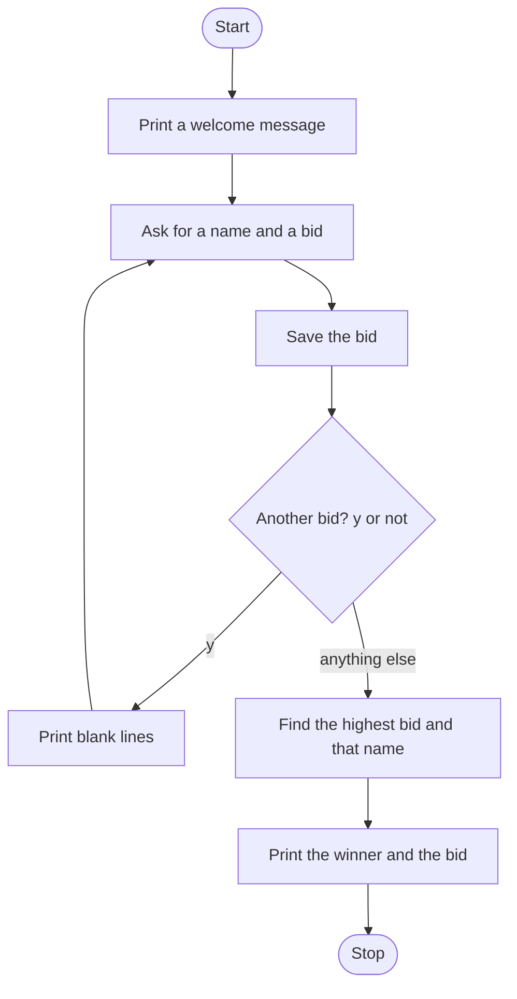

# Contractor Bid Board Rebuild Roadmap

Follow the stages in order. Finish and test one stage before you start the next, and only build what that stage asks for.

## The big picture

**One stage at a time:** write a stage, run it, and make sure it works before you touch the next one. If something breaks, it is almost always in the stage you just wrote.

## Stage 1: The board
1. **Welcome them.**
2. **Start an empty dictionary,** plus an empty winner name and a highest bid of 0, before the loop.
3. **A flag starts true.** Loop while it is true.

Test it: print the empty dictionary before anyone bids.

## Stage 2: One bid
1. **Ask for the name** and store it in lowercase.
2. **Ask for the bid** as a whole number, with a dollar sign in the question.
3. **Save the pair** right away. The name is the key.

Test it: enter one contractor and print the dictionary.

## Stage 3: More bids, and a clear screen
1. **Ask if there are any other bids,** and make the answer lowercase.
2. **Only `y` continues.** Print a stack of blank lines so the next contractor does not see the last bid, then ask again.
3. **Anything else stops the loop.** That includes `n`, `no`, and `yes`. The winner search goes in that else, so it runs once, when bidding stops.

Test it: enter three bids, saying `y` between them. Does the screen clear? Then type `yes` instead of `y`. Does the bidding stop?

## Stage 4: Highest bid wins
1. **Loop the keys.** How do you read the bid stored under each name?
2. **Keep the bid only when it is greater** than the highest so far, and keep that name with it.
3. **Print the winner after the loop,** in one sentence with the amount.

Test it: 400, 250, and 900. Does 900 get the job? Enter one bid and stop immediately. Does that single bid win?

## Stage 5: Tidy up and break it
1. **Break it on purpose.** `Y`, two contractors with the same name, or two equal highest bids. Which name survives an equal bid?
2. **Explain it out loud.** Why does the search sit in the else, and why is the print outside the loop?
