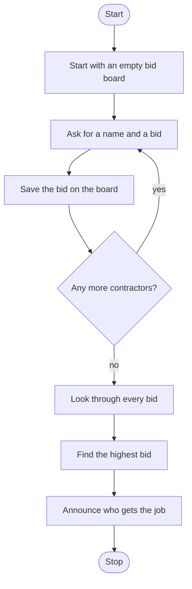

# Contractor Bid Board Roadmap

Follow the stages in order. Finish and test one stage before you start the next, and only build what that stage asks for.

## The big picture

**One stage at a time:** write a stage, run it, and make sure it works before you touch the next one. If something breaks, it is almost always in the stage you just wrote.

## Stage 1: The board
1. **Pick the data type.** Which type stores pairs, like a name and a bid?
2. **Start empty.** How do you make an empty one?

Test it: add one fake bid by hand and print the board. Does it look right?

## Stage 2: Take one bid
1. **Ask for the name and amount.** Which one needs to be a number?
2. **Save it.** How do you add a new key and value?

Test it: enter one bid and print the board. Is the name the key and the bid the value?

## Stage 3: Take more bids
1. **Pick the loop.** Which loop keeps going until nobody else wants to bid?
2. **The stop switch.** Which question ends the bidding, and which variable changes?

Test it: enter three bids. Are all three on the board?

## Stage 4: Find the winner
1. **Loop the board.** When you loop through a dictionary, do you get keys or values? How do you get the other one?
2. **Highest bid wins.** What should your "best so far" start at so the first real bid always beats it?
3. **Remember who.** Store the winner name along with the amount.

Test it: bids of 500, 300 and 800. Does the 300 contractor win?

## Stage 5: Bonus: nesting
1. **More info per contractor.** How can each value hold both a bid and years of experience? (A dictionary inside a dictionary?)
2. **Reach inside.** How do you get the bid out of the nested part?

Test it: print one contractor experience. Does the winner check still work?

## Stage 6: Tidy up and break it
1. **Break it on purpose.** Two contractors with the same name? A tie on the bid? "No" with a capital N?
2. **Explain it out loud.** Can you say what is a key and what is a value on your board?
