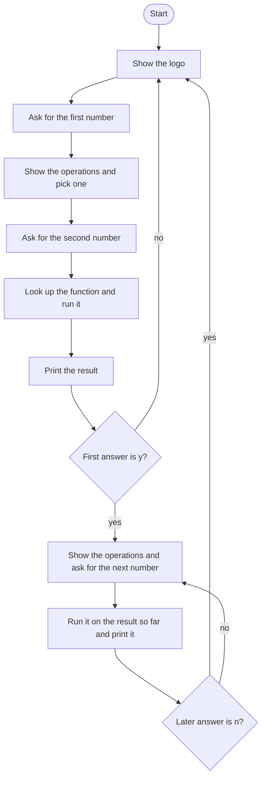

# Calculator Roadmap

Follow the stages in order. Finish and test one stage before you start the next, and only build what that stage asks for.

The logo is already in `art.py`.

## The big picture

**One stage at a time:** write a stage, run it, and make sure it works before you touch the next one. If something breaks, it is almost always in the stage you just wrote.

## Stage 1: The four functions
1. **Write add, subtract, multiply, and divide.** Each takes two numbers. Which keyword sends the answer back?
2. **Add a docstring** to each one.
3. **Return, do not print,** inside the function. What does returning let the rest of the program do with the answer?

Test it: print each function with 6 and 3. Do you get 9, 3, 18, and 2?

## Stage 2: The operations dictionary
1. **Map the symbols** `+`, `-`, `*`, and `/` to those four functions. Can a dictionary value be a function?
2. **Look one up and call it** with two numbers. The lookup gives you the function. The parentheses after it run it.

Test it: look up `*` and run it with 4 and 5. Do you get 20?

## Stage 3: One calculation
1. **Show the logo,** then ask for the first number. Allow decimals.
2. **Print every symbol** with a loop over the dictionary keys, then ask them to pick one.
3. **Ask for the second number,** call the function you looked up, and print the result by itself. This version does not print the whole equation.

Test it: 7 divided by 2. Do you get 3.5?

## Stage 4: Keep calculating with the result
1. **Ask** whether to continue with this result. The question names the result they would be continuing with.
2. **Only `y` on that first answer** enters the inner loop. Any other answer, including `n`, skips it.
3. **The inner loop** prints the symbols again, asks for an operation and the next number, runs that on the result so far, prints the new result, and asks again.
4. **Inside that loop, only `n` leaves it.** `y` keeps going, and so does any other answer. The new result is the number you keep calculating with.

Test it: 2 + 3, then `y`, then `*` 4. Do you get 20? Then `n`. Do the extra questions stop? Start over, get one result, and type `n` at the first continue question. Does it skip the inner loop?

## Stage 5: Start a new calculation
1. **The whole program sits in an outer loop** that shows the logo and asks for a fresh first number.
2. **Leaving the inner loop, or skipping it, starts that outer loop again.** The old result is not reused, because the next pass asks for a new first number.
3. **This file has no quit answer.** Both `n` paths start over. They are not the same check: the first continue question treats only `y` as "keep going", and every later continue question treats only `n` as "start over".

Test it: finish a chain, type `n`, and confirm the logo shows and the next first number starts from scratch. Do it again from the very first question, with `n` before any second operation.

## Stage 6: Tidy up and break it
1. **Break it on purpose.** Divide by 0? A symbol that is not in the dictionary? `Y` instead of `y`?
2. **The block that prints the symbols and asks for the next number is written twice,** once for the opening calculation and once inside the continue loop. Can you point at both copies?
3. **Explain it out loud.** How does a function live in a dictionary, and which loop forgets the old result?
