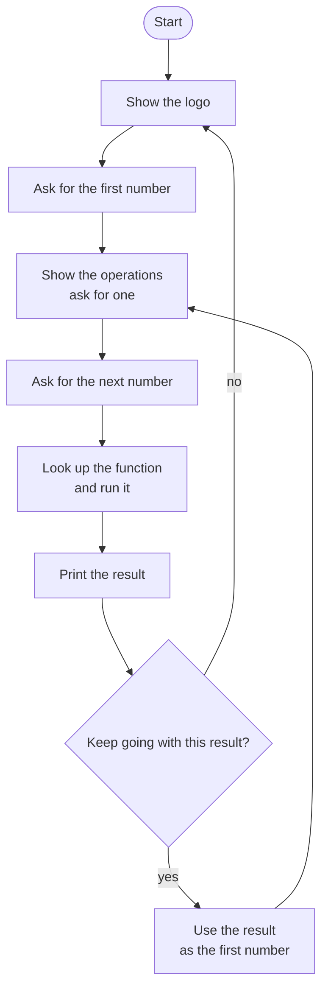

# Calculator Roadmap

Follow the stages in order. Finish and test one stage before you start the next, and only build what that stage asks for.

## The big picture

**One stage at a time:** write a stage, run it, and make sure it works before you touch the next one. If something breaks, it is almost always in the stage you just wrote.

## Stage 1: The four functions
1. **Write add, subtract, multiply and divide.** Each takes two numbers. Which keyword sends the answer back out?
2. **Print or return?** What is the difference, and which one lets you use the answer later?

Test it: print the result of each function with 6 and 3. Do you get 9, 3, 18 and 2?

## Stage 2: The operations dictionary
1. **Symbol to function.** Can a dictionary value be a function? What should the keys be?
2. **Run it from the dictionary.** How do you look up a function and then call it with two numbers?

Test it: look up "*" and run it with 4 and 5. Do you get 20?

## Stage 3: One calculation
1. **Ask for the first number.** Should it be a whole number or allow decimals?
2. **Show the choices.** How can a loop print every key in the dictionary?
3. **Ask for the operation and the second number**, then run it and print the result.

Test it: 7 / 2. Do you get 3.5?

## Stage 4: Keep going
1. **Carry the result.** If the player says yes, what becomes the new first number?
2. **Pick the loop.** Which loop repeats until they say no? What variable stops it?

Test it: 2 + 3, then keep going with * 4. Do you get 20?

## Stage 5: Start fresh
1. **New calculation.** When they say no, how do you go back to asking for a fresh first number?
2. **Bring in the logo.** How do you import it from another file?

Test it: finish one chain, say no, and start a new one. Does it forget the old result?

## Stage 6: Tidy up and break it
1. **Break it on purpose.** Divide by 0? Type a symbol that is not in the dictionary? What happens?
2. **Can it be shorter?** Is there repeated code you could put in a function? Could a function call itself to start over?
3. **Explain it out loud.** Can you say how a function can live inside a dictionary?
