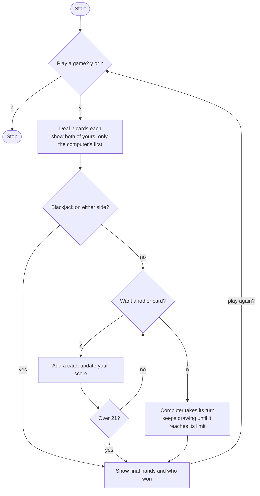

# Blackjack Roadmap

Follow the stages in order. Finish and test one stage before you start the next, and only build what that stage asks for.

## The big picture

**One stage at a time:** write a stage, run it, and make sure it works before you touch the next one. If something breaks, it is almost always in the stage you just wrote.

## Stage 1: One hand, no choices
1. **Make the deck.** You already have a list of card values. Where should it live so every part of the game can reach it?
2. **Deal your two cards.** Which random tool picks one item from a list? You need it twice. Put the result in a list called `your_cards`.
3. **Deal the computer's two cards.** Same idea, a second list.
4. **Work out each score.** Which built-in adds up a whole list?
5. **Print what the player should see.** Both of your cards and your score, but only the computer's first card.

Test it: run the file a few times. Do you get new cards each run, with the right totals?

## Stage 2: Check for a Blackjack
1. **Decide what counts as a Blackjack.** Which score, with how many cards?
2. **Handle each outcome.** Your Blackjack, the computer's Blackjack, or neither. What does the game print in each case, and does the player get to choose anything?
3. **Keep the outcomes separate.** Use one if, elif, else chain. Which branch leads to the next stage?

Test it: to force a Blackjack, temporarily put 11 and 10 in your starting cards. Does the right message show?

## Stage 3: Let the player draw
1. **Ask the question inside a loop.** Which loop repeats until something happens? What variable tells it to stop?
2. **Add a card when the answer is y.** Which list method adds one item to the end?
3. **Recalculate and show your hand.** Which line from Stage 1 do you need to run again?
4. **Decide when the loop ends.** Two ways: you answer n, or your score goes over 21. What do you set in each case?

Test it: press y several times in a row. Do the same cards stay and a new one get added each time?

## Stage 4: Aces
1. **Know the rule.** An ace counts as 11, but if your score is over 21 it can count as 1 instead.
2. **Check the right moment.** When should you look for an 11 in the hand? Before or after you decide the player went over?
3. **Change only one ace per check.** Which list method finds a value, and which one swaps it for another?

Test it: force a hand like 11, 11, 5 and see if the score comes out right.

## Stage 5: The computer's turn
1. **Pick the rule.** The computer keeps drawing while its score is below a limit. What limit does your game use?
2. **Pick the loop.** Which loop fits something that repeats while a condition is true?
3. **Remember its aces too.** Does the Stage 4 idea need to run here as well? Is there a way to avoid writing it twice?

Test it: pass right away and watch the computer's hand grow. Does it stop at the right point?

## Stage 6: Decide the winner
1. **List every outcome.** Both over, you over, computer over, a draw, you higher, computer higher. Write them on paper first.
2. **Put them in the right order.** Which check must come first so a busted hand never wins?
3. **Print both final hands and scores.** Use the full computer hand, not just its first card.

| Your score | Computer score | Who should win? |
|---|---|---|
| Over 21 | Any | Think it through |
| 21 or less | Over 21 | Think it through |
| Same | Same | Think it through |
| Higher | Lower | Think it through |

Test it: run many games and check the winner against the table by hand.

## Stage 7: Play again
1. **Ask once, at the end of every game.** Put the question in one place that every outcome reaches, not copied into each branch.
2. **Choose how to restart.** Either put the whole game in a function and call it again, or wrap it in a loop. Which is simpler for you to follow?
3. **Stop cleanly on n.** What should the program do and print when the player says no?

Test it: play three games in a row, then say n. Does everything reset each time?

## Stage 8: Tidy up
1. **Remove repeated code.** Are there two or three lines you copied in several places? Which ones could become small functions?
2. **Break it on purpose.** Type a wrong answer like a space or a capital letter. What happens? Does `.lower()` help?
3. **Explain it out loud.** Can you say what every line does without peeking?
