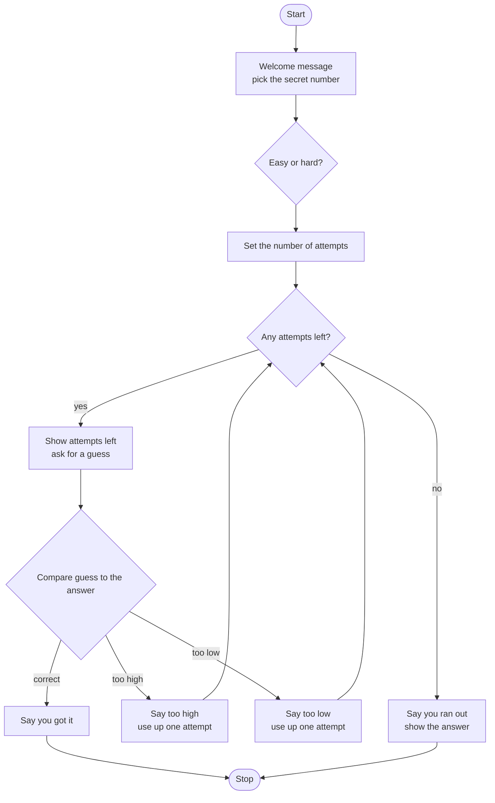

# Number Guessing Game Roadmap

Follow the stages in order. Finish and test one stage before you start the next, and only build what that stage asks for.

> I couldn't read the demo page (it only runs in the browser), so this roadmap follows the usual Day 12 game: a secret number from 1 to 100, a difficulty choice, and a limited number of guesses. Run the demo and tell me if anything differs.

## The big picture

**One stage at a time:** write a stage, run it, and make sure it works before you touch the next one. If something breaks, it is almost always in the stage you just wrote.

## Stage 1: The secret number
1. **Import the tool.** Which module picks random numbers?
2. **Pick the number.** Which function gives a whole number between two values? Is the top value included?
3. **Print a welcome message.** Say the range you are thinking of.
4. **Peek while building.** Temporarily print the secret so you can test later stages.

Test it: run it five times. Is the number always between 1 and 100, and does it change?

## Stage 2: One guess, one answer
1. **Ask for the guess.** Which function reads what the player types? What type does it give back?
2. **Turn it into a number.** Which function changes text into a whole number?
3. **Compare.** Which if / elif / else chain covers too high, too low and correct?
4. **Print the right message** in each branch.

Test it: with the secret showing, guess too high, too low and exactly right. Do you get the right message each time?

## Stage 3: Difficulty
1. **Ask the question.** What are the two choices?
2. **Set the attempts.** Easy gets more attempts, hard gets fewer. What are your numbers?
3. **Where does that number live?** Think back to today's lesson on scope. Who needs to see it, and where is it created?

Test it: pick each difficulty and print the attempts. Does each one show the right number?

## Stage 4: Repeat the guessing
1. **Pick the loop.** Which loop repeats until something happens? What variable tells it to stop?
2. **Show the attempts left** before every guess.
3. **Use up an attempt** after every wrong guess. Should a correct guess use one up?
4. **Stop on a correct guess.** How does the loop know to end?

Test it: guess wrong three times, then right. Does the attempts count go down each time and the loop end on the win?

## Stage 5: Running out of attempts
1. **Spot the end.** What value of attempts means the player lost?
2. **Say it.** Print a message and show the secret number.
3. **Check the order.** Does the loss message show up when the player wins on their last try? Why not?

Test it: choose hard and guess wrong until you run out. Then win on your very last attempt. Do both end correctly?

## Stage 6: Turn it into functions
1. **Find the pieces.** What does the game do that you could name? For example setting the difficulty, or checking one guess.
2. **Pass things in and send things back.** Which values does each piece need? Which value does it have to send back so the rest of the game sees the change? Remember: `return` instead of changing a global.
3. **Keep the main code short.** Can the main flow read almost like plain English?

Test it: play a full game again. Does it behave exactly like before?

## Stage 7: Tidy up and break it
1. **Break it on purpose.** Type a word, a blank, or a number outside 1 to 100. What happens?
2. **Check your inputs.** Which of today's ideas helps if the player types the difficulty in capital letters?
3. **Explain it out loud.** Can you say what every line does, and where every variable lives, without peeking?
