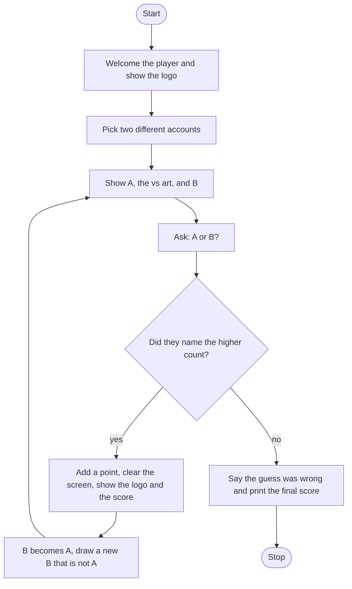

# Higher Lower Roadmap

Follow the stages in order. Finish and test one stage before you start the next, and only build what that stage asks for.

The account list is already in `game_data.py`. The logo and the vs art are already in `art.py`. Each account is a dictionary with a name, a description, a country, and a follower count.

## The big picture

**One stage at a time:** write a stage, run it, and make sure it works before you touch the next one. If something breaks, it is almost always in the stage you just wrote.

## Stage 1: Two different accounts
1. **Import `random`, the logo, the vs art, and the data.**
2. **Print a welcome line, then the logo.** Start the score at 0.
3. **Pick one account for A and one for B.** The data is a list of dictionaries. Which random function picks one item?
4. **If A and B are the same account, pick B again** until they differ. Which loop fits "keep going while they match"?

Test it: print both names a few times. Are they ever the same account twice in one pair?

## Stage 2: Show an account
1. **Write `format_account`.** It takes one account dictionary and returns one string: name, description, and country. Add a docstring.
2. **It does not include the follower count.** The player is not supposed to see that yet. How do you pull one value out of a dictionary by its key?
3. **Print "Compare A", the vs art, and "Against B".**

Test it: run it. Do you see a name, a description, and a country on each side, with no follower count?

## Stage 3: Check the guess
1. **Ask who has more followers,** A or B, and make the answer lowercase.
2. **Write `check_answer`.** It takes the guess and the two follower counts, and returns True or False. Add a docstring.
3. **If A's count is greater, the guess is correct only when it is `a`.** Otherwise the guess is correct only when it is `b`. A tie follows that second path, so `b` is the answer the function accepts.
4. **Return the comparison.** Do not print inside the function. The caller decides what to say.

Test it: call it with counts you pick yourself. Try A higher, B higher, and a tie. Does each one return True only for the answer you expect?

## Stage 4: A wrong guess ends the game
1. **A flag starts false** for "game over", and a loop runs while it is not over.
2. **The first comparison is printed before that loop.** The later comparisons are printed from inside the correct-guess branch.
3. **A wrong guess sets the flag** and prints the final score. It does not draw a new pair.

Test it: peek at the two follower counts and guess wrong on purpose. Does the score print as 0, and do the questions stop?

## Stage 5: A right guess continues
1. **Add 1 to the score.**
2. **Clear the screen** by printing a run of blank lines, show the logo again, and print the current score with a short "you're right" line.
3. **The old B becomes the new A,** both the account and the formatted line.
4. **Draw a new B** that is not the same account as A, format it, and print A, the vs art, and B again.
5. **Then the loop asks** for another guess. The score carries over. It is not reset.

Test it: get one right, then one wrong. Is the final score 1, and is the second A the account that was B?

## Stage 6: Tidy up and break it
1. **Break it on purpose.** `A` in capitals? The word `yes`? A blank line?
2. **Play three correct guesses in a row.** Is the score 3, and does a pair ever show the same account on both sides?
3. **Explain it out loud.** What does `format_account` return, and what does `check_answer` return?
