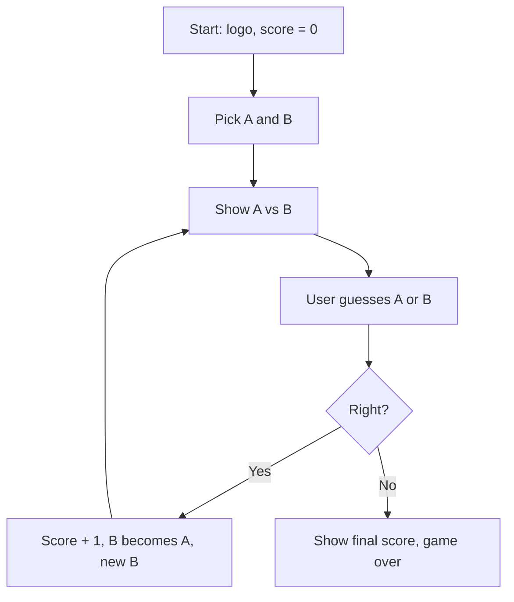

# Higher Lower Roadmap (Day 14)

**Stage 1: Setup (TODOs 1–2).** Hint: the data is a list of dictionaries. Test: print the length of the data list.
**Stage 2: Pick two accounts (TODO 3).** Hint: random has a function that picks one item from a list. Test: print both and run it a few times.
**Stage 3: Format an account (TODOs 4–5).** Hint: pull values out of the dictionary by key and use an f-string. Test: you should see "Compare A: name, a description, from country".
**Stage 4: Check the answer (TODOs 6–7).** Hint: first work out which account has more followers, then compare that with the guess. Test: guess both ways for a pair you know.
**Stage 5: Score (TODOs 8–9).** Hint: a variable that lives outside the loop. Test: get one right, then one wrong.
**Stage 6: Loop (TODOs 10–11).** Hint: a True/False flag controls the while loop. Test: three right answers in a row and the score is 3.
**Stage 7: Polish (TODOs 12–13).** Hint: keep picking B while it equals A. Test: play 10 rounds and never see a repeat pair.

Rule: one stage at a time, and test before moving on.
