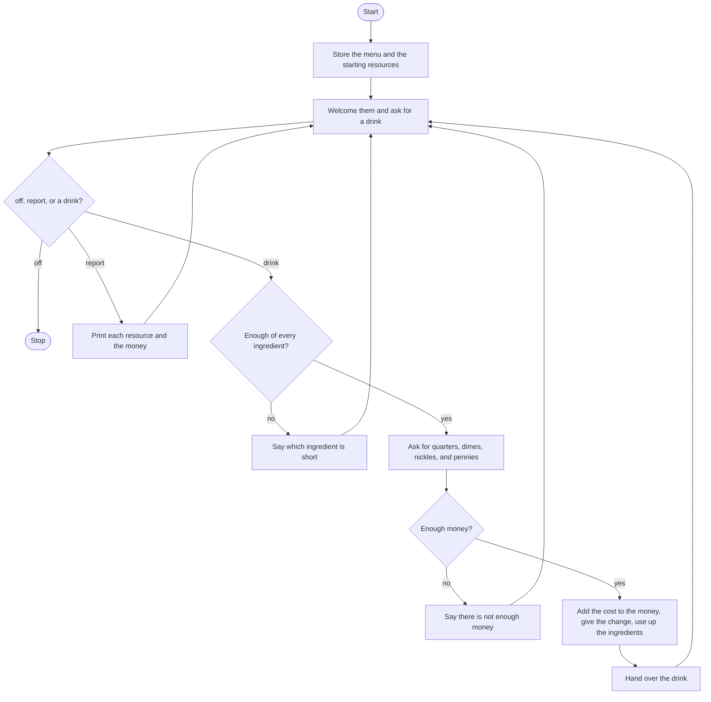

# Coffee Machine Roadmap

Follow the stages in order. Finish and test one stage before you start the next, and only build what that stage asks for.

## The big picture

**One stage at a time:** write a stage, run it, and make sure it works before you touch the next one. If something breaks, it is almost always in the stage you just wrote.

## Stage 1: The menu and the resources
1. **A dictionary of drinks.** Espresso, latte, and cappuccino. Each drink holds an ingredients dictionary and a cost.
2. **Espresso has water and coffee, and no milk.** Latte and cappuccino have all three. Espresso costs 1.5, latte 2.5, cappuccino 3.0.
3. **A second dictionary** starts the machine at 300 water, 200 milk, and 100 coffee.
4. **Money starts at 0,** outside the loop, so a later order can add to it.

Test it: print one drink's cost and its ingredients. Then print the starting water.

## Stage 2: Ask until they turn it off
1. **Loop while a flag says the machine is still on.**
2. **Each pass prints a welcome,** then asks what they would like: espresso, latte, or cappuccino. Make the answer lowercase.
3. **`off` flips the flag** and the loop ends. It does not print a goodbye.

Test it: order nothing, type `off`. Does it stop without making a drink?

## Stage 3: report
1. **`report` prints every resource** by looping the resources dictionary: the key, then the amount.
2. **Then print the money** with a dollar sign.
3. **Go back to the question.** Do not make a drink.

Test it: type `report` on a fresh machine. Do you see water 300, milk 200, coffee 100, and money 0?

## Stage 4: Enough ingredients?
1. **Write `is_resource_sufficient`.** It takes the drink's ingredients and returns True or False. Add a docstring.
2. **Loop the ingredients that drink uses.** If the machine has less than the drink needs, print which ingredient is short and remember that the answer is False.
3. **Check every ingredient,** even after one of them is short. A drink can be short on more than one thing.
4. **Call it with the chosen drink's ingredients** before you ask for coins. A False result skips payment and goes back to the question.

Test it: set water to 0 by hand and order a latte. Do you see a "not enough water" line, and are you not asked for coins? Put the water back after.

## Stage 5: Count the coins
1. **Write `process_coins`.** It returns the total in dollars. Add a docstring.
2. **Ask how many quarters, dimes, nickles, and pennies.** Quarters are 0.25, dimes 0.10, nickles 0.05, pennies 0.01. The prompt spells it `nickles`.
3. **Add the four amounts and return the total.** Do not print it inside the function.

Test it: call it with 4 quarters and 0 of the rest. Does it return 1.0?

## Stage 6: Pay, then make the drink
1. **If the coins are less than the cost,** say there is not enough money and do not change the resources or the money total.
2. **Otherwise** add the drink's cost to the money, not the whole coin total. The change is the coins minus the cost, rounded to 2 decimal places. Print the change.
3. **Subtract each ingredient** the drink used from the resources.
4. **Then say the drink is ready,** naming the drink they ordered.

Test it: order an espresso and pay with 10 quarters. Espresso costs 1.5, so the change is 1.0. Does a report show water 250, milk still 200, coffee 82, and money 1.5? On the next order, pay with one penny. Does the money stay 1.5, and do the resources stay put?

## Stage 7: Tidy up and break it
1. **Break it on purpose.** `OFF`? `Report`? A drink name that is not on the menu? This program looks that name up in the menu directly, so a missing drink does not get its own message.
2. **Order until the water runs out,** then order again. Does the sorry line name the ingredient, and does `off` still stop the machine?
3. **Explain it out loud.** What does `process_coins` return, and what does `is_resource_sufficient` return?
