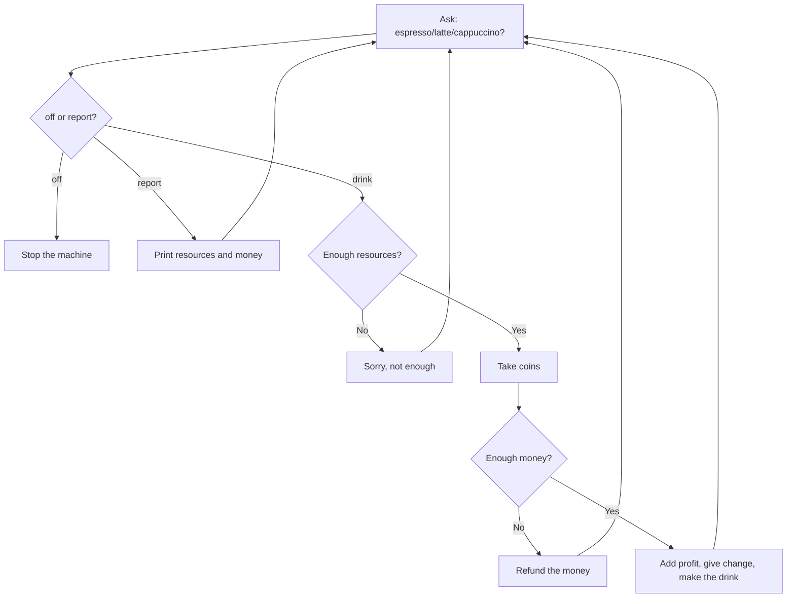

# Coffee Machine Roadmap (Day 15)

**Stage 1: Ask for a drink (TODO 1).** Hint: input() with the exact question "What would you like? (espresso/latte/cappuccino)". Test: print what you typed.
**Stage 2: Off and keep asking (TODO 2).** Hint: a True/False flag controls the while loop, and "off" flips it. Test: order twice, then type "off" and it stops.
**Stage 3: Report (TODO 3).** Hint: pull each value out of the resources dictionary by key and use an f-string; money starts at 0. Test: type "report" and see water, milk, coffee and money.
**Stage 4: Check resources (TODO 4).** Hint: loop through the drink's ingredients and compare each one with what the machine has. Test: drain the water and you should see "Sorry there is not enough water."
**Stage 5: Process coins (TODO 5).** Hint: ask how many of each coin, then multiply by its value (quarters 0.25, dimes 0.10, nickels 0.05, pennies 0.01) and add them up. Test: 4 quarters should total 1.0.
**Stage 6: Check the transaction (TODO 6).** Hint: compare the total with the drink's cost; if short, refund, if not, add the cost to profit and round the change to 2 decimals. Test: pay too little, then pay too much.
**Stage 7: Make the coffee (TODO 7).** Hint: subtract each ingredient from the resources dictionary. Test: you should see "Here is your latte ☕ Enjoy!" and the report should show less left.

Rule: use clear variable names, one stage at a time, and run it after every TODO.
