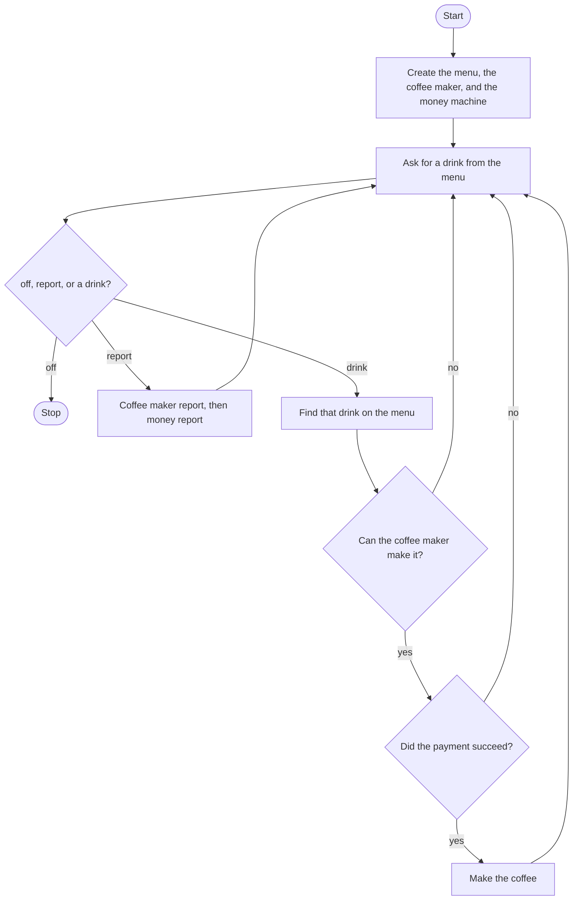

# OOP Coffee Machine Roadmap

Follow the stages in order. Finish and test one stage before you start the next, and only build what that stage asks for.

`menu.py`, `coffee_maker.py`, and `money_machine.py` are already written. Your code is `main.py`. Read each class for the method names before you call them. Do not rewrite the classes.

## The big picture

**One stage at a time:** write a stage, run it, and make sure it works before you touch the next one. If something breaks, it is almost always in the stage you just wrote.

## Stage 1: The three objects
1. **Import `Menu`, `CoffeeMaker`, and `MoneyMachine`.**
2. **Create one of each.** Which class knows the drinks, which one holds the water, milk, and coffee, and which one tracks the profit?
3. **Ask the menu for its item list once,** before the loop, and keep that string for the prompt.

Test it: print the item list. Do you see the drink names?

## Stage 2: Ask until off
1. **Loop while a flag says the machine is on.**
2. **Each pass asks what they would like,** and includes the item list in the question. Make the answer lowercase.
3. **`off` flips the flag.** There is no goodbye line.

Test it: type `off` immediately. Does the program end?

## Stage 3: report
1. **`report` asks the coffee maker to report, then the money machine.** Two calls, in that order.
2. **You do not print the resources yourself.** The methods already know what to print.
3. **Then ask again.**

Test it: type `report` on a fresh machine. Do you see water, milk, coffee, and money at 0?

## Stage 4: Find the drink, check it, take payment, make it
1. **Anything that is not `off` or `report`** is a drink name. Ask the menu to find it.
2. **Ask the coffee maker** whether its resources are enough for that drink. Which method returns True or False, and which argument does it want?
3. **Only when that returns True,** ask the money machine to take payment for the drink's cost. That method returns True when the payment is enough.
4. **Only when the payment returns True,** tell the coffee maker to make the coffee.
5. **A failed resource check or a failed payment** skips the rest and asks for another drink. You do not write the sorry messages or the coin questions. Those methods already do.

Test it: order a latte and pay with enough coins. Does the drink get served? Type `report`. Are the resources lower, and is the money the cost of the latte? Order again and pay with one penny. Does the report stay the same?

## Stage 5: Tidy up and break it
1. **Break it on purpose.** `OFF`? `Report`? A drink that is not on the menu? What does the menu's find method return when the name is missing, and what happens if that value is handed to the resource check?
2. **Explain it out loud.** Which object do you ask about ingredients, which one do you ask about coins, and which one do you ask to make the drink?
