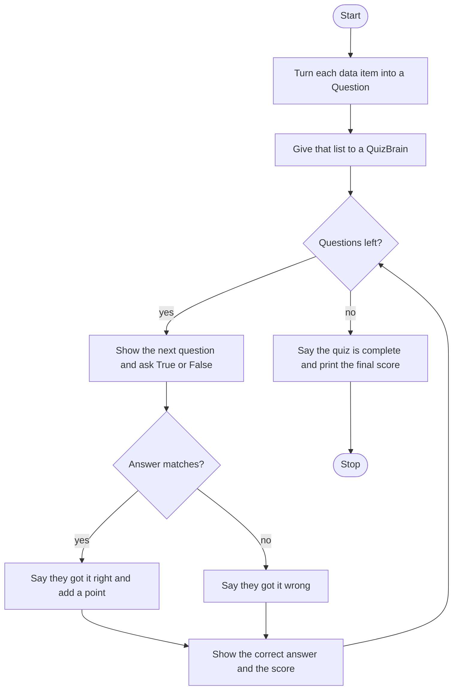

# Quiz Game Roadmap

Follow the stages in order. Finish and test one stage before you start the next, and only build what that stage asks for.

The questions are already in `data.py`. Each item is a dictionary. This program uses the question text and the correct answer. It does not add new questions.

## The big picture

**One stage at a time:** write a stage, run it, and make sure it works before you touch the next one. If something breaks, it is almost always in the stage you just wrote.

## Stage 1: One question
1. **In `question_model.py`, define a `Question` class.** Give the class a docstring.
2. **`__init__` takes the text and the answer** and stores them on the object. Add a docstring there too.
3. **Creating a Question does not print it.** How do you read the text back off the object?

Test it: make one Question by hand and print its text and its answer.

## Stage 2: The question bank
1. **In `main.py`, start with an empty list.**
2. **Loop `question_data`.** Each item is a dictionary. Which keys hold the question text and the correct answer?
3. **Make a Question from those two values** and append it to the bank.

Test it: print the length of the bank and the text of the first Question. Does the length match the data list?

## Stage 3: A QuizBrain that can hold them
1. **In `quiz_brain.py`, define `QuizBrain`.** `__init__` takes the question list and stores it. Add docstrings.
2. **Also store a question number and a score,** both starting at 0.
3. **`still_has_questions` returns True** when the question number is still less than the length of the list, and False when it is not.

Test it: build a QuizBrain with two Questions and print `still_has_questions`. Then set the question number to 2 by hand and print it again. True, then False?

## Stage 4: Ask one question
1. **`next_question` takes the question at the current number,** then adds 1 to the number before it asks. The number the player sees therefore starts at 1, not 0.
2. **Ask True or False** and include the question text in the prompt.
3. **Pass the player's answer and the question's answer** to `check_answer`.

Test it: call `next_question` once. Does the prompt start with question 1, and is the text the first question's text?

## Stage 5: Check the answer and keep score
1. **Compare the two answers in lowercase,** so `true` and `True` can match.
2. **A match** says they got it right and adds 1 to the score. Anything else says they got it wrong. The score does not change on a wrong answer.
3. **Either way,** print the correct answer, then the score out of the question number, then a blank line.

Test it: answer one question right and one wrong. Is the score 1 out of 2 after the second?

## Stage 6: Run the quiz
1. **Hand the bank to a QuizBrain.**
2. **Loop while `still_has_questions` is true,** and call `next_question` each pass.
3. **After the loop,** say the quiz is complete and print the final score out of the number of questions asked.

Test it: play the whole bank. Does it stop on its own, and does the final line use the same score you had on the last question?

## Stage 7: Tidy up and break it
1. **Break it on purpose.** `TRUE`, `false`, `maybe`, or a blank line. Which of those count as correct when the answer is True?
2. **Explain it out loud.** What does a Question remember, and what three things does a QuizBrain remember?
