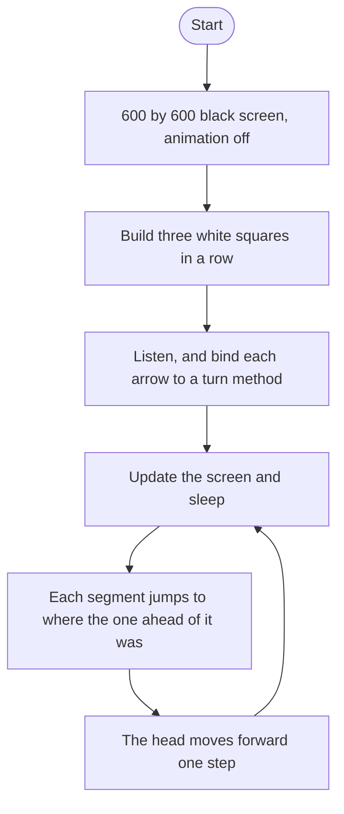

# Snake Roadmap

Follow the stages in order. Finish and test one stage before you start the next, and only build what that stage asks for.

This program opens a turtle window. The snake moves and turns. That is the whole game.

## The big picture

**One stage at a time:** write a stage, run it, and make sure it works before you touch the next one. If something breaks, it is almost always in the stage you just wrote.

## Stage 1: The screen
1. **Import `Screen` from turtle.**
2. **Set it up** 600 wide and 600 tall, with a black background and the title `My Snake Game`.
3. **Put `exitonclick` on the last line** so you can close the window. The game loop, once it exists, goes above that line.

Test it: run it. Do you get a black window with that title, and does a click close it?

## Stage 2: Three squares, then a loop
1. **Three white squares in a row, with no gaps.** A turtle's square is 20 pixels wide. If the front square sits at `(0, 0)`, where do the other two sit?
2. **Write the three turtles out once** so you can see the row. Then replace that copy-paste with a loop over a list of those starting positions.
3. **Square shape, white color.**

Test it: do you see three white squares touching, in a horizontal row?

## Stage 3: No lines, and no animation
1. **Lift the pen** before a segment moves to its start. What gets drawn between the squares if you forget?
2. **Turn the animation off** with the screen's tracer, passing 0. The screen then stays still until you tell it to refresh.
3. **Refresh once** after the squares exist, so you can see them. Which screen method paints the pending changes?

Test it: the three squares appear in place, and there is no line connecting them.

## Stage 4: The snake moves itself
1. **Import `time`.** A flag starts true, and a loop runs while it is true.
2. **Each pass refreshes the screen, sleeps for a tenth of a second, then moves the snake.**
3. **Move the body from the back toward the front.** The last segment jumps to where the one ahead of it is, then the next one does the same, and you stop before the head. Which `range` counts backward and stops before 0? You need each segment's `xcor` and `ycor`, then `goto`.
4. **Then move the front square forward.**
5. **This flag never becomes false.** `exitonclick` is under the loop, so it does not run while the snake is moving. Closing the window is how you stop.

Test it: the three squares should travel together in a line. The tail should follow the head, not stay behind or pile up on one spot.

## Stage 5: A Snake class
1. **Make `snake.py` with a `Snake` class.** Creating one snake builds the three segments by itself.
2. **In `__init__`, start `self.snake` as an empty list,** call `create_snake`, then save `self.head` as the first segment. Anything the object owns needs `self` in front of it.
3. **`create_snake` loops the starting positions.** For each one: a square turtle, white, pen up, `goto` that position, then append it to `self.snake`. Give the method a docstring.
4. **Pull the positions and the step size out as constants** at the top of `snake.py`. The positions are `(0, 0)`, `(-20, 0)`, and `(-40, 0)`. The step is 20. This program names that step `MOVING_DISTANCE`.

Test it: `snake = Snake()` from `main.py` still shows the same three squares. Is `snake.head` the segment that started at `(0, 0)`?

## Stage 6: move, and a short main.py
1. **`move` does the old tail-follows-head loop,** then `self.head.forward(MOVING_DISTANCE)`. Add a docstring.
2. **Use `self.head` in `move`,** not `self.snake[0]` again.
3. **Trim `main.py`.** It should set up the screen, turn the tracer off, create one `Snake`, and call `snake.move()` inside the loop. The segment-building code does not stay in `main.py`.

Test it: the snake still glides the same way. `main.py` no longer builds turtles of its own.

## Stage 7: The arrow keys
1. **After you create the snake, `listen` for keystrokes.**
2. **Bind the four arrows.** The key names are `"Up"`, `"Down"`, `"Left"`, and `"Right"`. `onkey` wants the method itself. What happens if you write `snake.up()` with the parentheses, instead of `snake.up`?
3. **Add `up`, `down`, `left`, and `right` on `Snake`.** Each one calls `setheading` on `self.head`.
4. **Headings go counterclockwise from 0, which is east.** North is 90, west is 180, south is 270. A turtle starts facing east, so with no key the snake moves right.
5. **Name those four headings** `UP`, `DOWN`, `LEFT`, and `RIGHT` next to the other constants.

Test it: press each arrow. Does the snake turn that way and keep moving?

## Stage 8: Do not reverse
1. **`heading()` is a method.** It tells you which way the head is already facing. Call it. Don't treat it like a stored number.
2. **`up` turns only when the head is not already heading down.** `down` refuses up. `left` refuses right. `right` refuses left.
3. **A turn to the side is still allowed.** Only the exact opposite is blocked.

Test it: while the snake moves right, press Left. Does it refuse to flip backward? Press Up. Does it turn?

## Stage 9: Tidy up and break it
1. **Break the binding on purpose.** Pass `snake.up()` with parentheses. What does `onkey` receive, and does the key still turn the snake?
2. **Explain it out loud.** Why does `move` shift the tail before the head steps forward, and why does that loop walk from the back?
