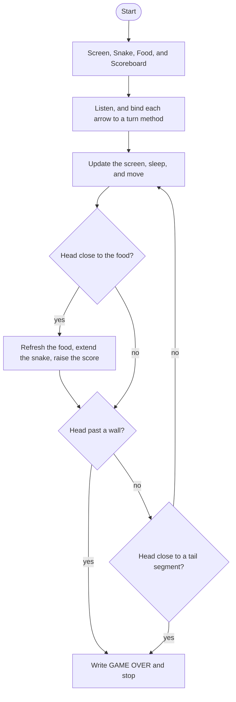

# Snake Roadmap

Follow the stages in order. Finish and test one stage before you start the next, and only build what that stage asks for.

This program opens a turtle window. The snake eats food, grows, and the game ends when it hits a wall or its own tail.

Start from the finished Day 20 snake: a 600 by 600 black screen, a `Snake` that moves and turns with the arrow keys, and a loop that updates and sleeps. Food, the score, and game-over are what this day adds.

## The big picture

**One stage at a time:** write a stage, run it, and make sure it works before you touch the next one. If something breaks, it is almost always in the stage you just wrote.

## Stage 1: Food inherits from Turtle
1. **Make `food.py` with a `Food` class that inherits from `Turtle`.** The parent class goes in parentheses after the name.
2. **In `__init__`, run the Turtle initializer** with `super().__init__()`. Food itself is a turtle. You do not make a second turtle and store it on `self`.
3. **Give the class a docstring.**

Test it: `food = Food()` in `main.py` should put a turtle on the screen. It will still look like the default turtle until the next stage.

## Stage 2: How the food looks
1. **Make it a circle,** lift the pen, and set a color. The lesson used blue.
2. **Shrink it to 10 by 10.** A turtle's default size is 20 by 20. `shapesize` stretches length and width. What factor turns 20 into 10?
3. **Set speed to `"fastest"`** so you do not see it animate from the center to its first spot.

Test it: do you see a small blue circle, with no line behind it?

## Stage 3: A random spot, and refresh
1. **The screen is 600 by 600,** so the axes go to 300. Do not place the food right at the edge.
2. **Pick a random x and a random y,** then `goto` that point. This program uses `random.randint(-250, 250)` for both.
3. **Pull that move into a `refresh()` method** and call `self.refresh()` from `__init__`. Name it `refresh`, not Turtle's `reset`. Give every function a one-sentence docstring.

Test it: each time you run the program, the food should appear in a different place.

## Stage 4: Eating the food
1. **After `snake.move()` in the game loop,** check whether the head has reached the food.
2. **Use the head's `distance` to the food.** If that distance is less than 15, the snake has eaten it.
3. **On a hit, call `food.refresh()`** so the food jumps to a new spot. Do not grow the snake or change the score yet.

Test it: when the head touches the food, does the circle move to a new random place?

## Stage 5: A Scoreboard class
1. **Make `scoreboard.py` with a `Scoreboard` class that inherits from `Turtle`.** In `__init__`, run the Turtle initializer and set `self.score` to 0. That starting 0 happens once, when the object is created.
2. **Set up the turtle before you write anything:** color it white, hide it, lift the pen, and move to the top center. This program uses `(0, 270)`. What happens if you write first and only then hide and move?
3. **Write the starting score** so it reads `Score: 0`. The font argument is a tuple of name, size, and style, not a single string. This program uses `("Arial", 17, "normal")`.
4. **Pull `ALIGNMENT` and `FONT` out as constants** at the top of the file.

Test it: do you see `Score: 0` in white at the top, with no turtle shape and no line?

## Stage 6: update and increase_score
1. **`update()` only writes the current score.** Call it from `__init__` after setup so `Score: 0` appears at the start.
2. **`increase_score()` adds 1 to `self.score`,** clears the old text, then calls `update()`. Use `self.score += 1`. `__init__` already set it to 0 once, and `__init__` does not run again when the snake eats.
3. **Put `clear()` in `increase_score`, not in `update`.** If clear lives in `update`, the first write from `__init__` clears a blank screen.
4. **In the food-collision branch,** call `scoreboard.increase_score()`. Do not also call `scoreboard.update()` — `increase_score` already does that.

Test it: each time the snake eats, does the number go up by one, and does the old number disappear instead of stacking on itself?

## Stage 7: The wall, and GAME OVER
1. **Add `game_over()` on the scoreboard.** It goes to `(0, 0)` and writes `GAME OVER` with the same alignment and font. Do not clear first, so the final score stays visible at the top.
2. **After the food check, detect a wall hit.** The screen goes to 300. This program treats 280 as the boundary on all four sides.
3. **If the head's `xcor()` or `ycor()` has gone past 280** in any direction, set `game_is_on` to `False` and call `scoreboard.game_over()`. One `if` with `or` covers all four sides.

Test it: drive the snake into a wall. Does `GAME OVER` appear in the middle, and does the final score stay at the top? Does the snake stop?

## Stage 8: The snake grows
1. **In `snake.py`, pull "create one segment at a position" out of the `create_snake` loop** into an `add_segment(position)` method. `create_snake` just loops and calls `self.add_segment(position)`.
2. **Add `extend()`** that puts a new segment at the last segment's current position. The last item in a list is `[-1]`. `position()` is a method, so it needs parentheses.
3. **On a food hit,** also call `snake.extend()`. Give every new function a one-sentence docstring.

Test it: each time the snake eats, does a new square appear at the tail, and does the whole body keep following the head?

## Stage 9: Hitting the tail
1. **After the wall check, loop through the snake's segments.** This program stores them on `snake.snake`.
2. **If the head's distance to a segment is less than 10,** set `game_is_on` to `False` and call `scoreboard.game_over()`.
3. **Skip the head** — the first segment — or you get instant game over. Why? What is the head's distance to itself?

Test it: grow the snake, then turn it into its own body. Does the game end? Does it still run fine when the snake is short and not touching itself?

## Stage 10: A slice instead of skip
1. **A slice is `[start:end]`.** The end number is not included. If you omit the end, the slice goes to the last item.
2. **Replace the "skip the head" if with a slice.** Loop over `snake.snake[1:]` — from the second segment to the end — then use a single `if` for the distance check.
3. **`[::-1]` reverses a sequence.** Slicing also works on tuples.

Test it: tail collision should work the same as Stage 9, with a shorter loop.

## Stage 11: Tidy up and break it
1. **Leave the head in the loop on purpose.** Write `for segment in snake.snake:` with no slice. What happens the instant the game starts, and why?
2. **Drop the parentheses on `position` in `extend`.** What gets passed into `add_segment`, and does a new segment appear where the tail is?
3. **Explain it out loud.** Why does `game_over` skip `clear()`, and why does `increase_score` clear before it writes the new score?
