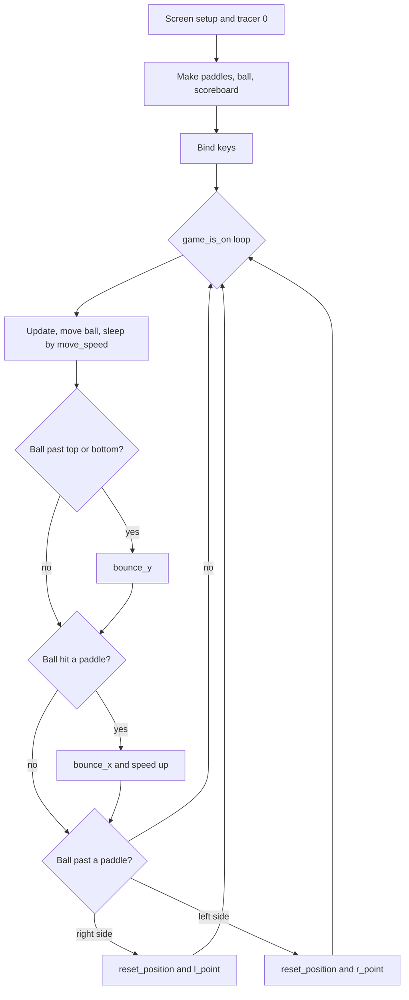

# Day 22 Roadmap: Pong

1. **Screen**: 800x600, black, titled "Pong", exitonclick.
2. **One paddle**: a white square stretched to 20x100 at (350, 0), moved 20 px with the Up/Down keys. Turn animation off with tracer(0) before making turtles, and redraw with screen.update() in a game_is_on loop.
3. **Paddle class**: move the paddle code into paddle.py as Paddle(Turtle) with a position parameter. Make r_paddle (350, 0) and l_paddle (-350, 0). The left paddle uses w/s.
4. **Ball class**: ball.py, Ball(Turtle), a white circle at the center. move() goes up and right each frame; slow it with time.sleep.
5. **Wall bounce**: x_move/y_move attributes. When y passes ±280, bounce_y() flips y_move (*= -1).
6. **Paddle bounce**: distance < 50 AND x past ±320, then bounce_x() flips x_move.
7. **Misses**: x past ±400 calls reset_position(), which goes to the center and serves the other way.
8. **Scoreboard**: scoreboard.py with l_score/r_score written at (∓100, 200). A right miss is l_point(), a left miss is r_point(). update_scoreboard() clears first.
9. **Speed-up**: move_speed starts at 0.1, the loop sleeps by it, bounce_x multiplies it by 0.9, and reset puts it back to 0.1.

