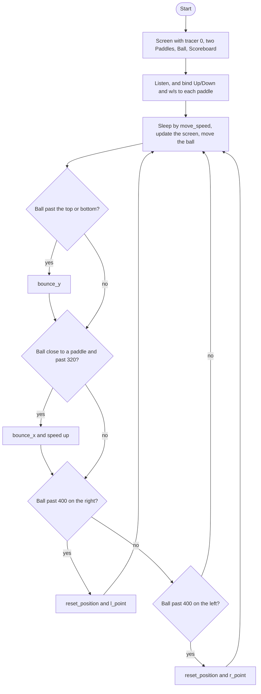

# Pong Roadmap

Follow the stages in order. Finish and test one stage before you start the next, and only build what that stage asks for.

This program opens a turtle window for a two-player Pong game. Each player moves a paddle, the ball bounces off the walls and paddles, a miss gives the other player a point, and the ball speeds up every time a paddle hits it.

Start from an empty project. You'll make four files: `main.py`, `paddle.py`, `ball.py`, and `scoreboard.py`.

## The big picture

**One stage at a time:** write a stage, run it, and make sure it works before you touch the next one. If something breaks, it is almost always in the stage you just wrote.

## Stage 1: The screen
1. **Make a `Screen`** that is 800 wide and 600 tall, with a black background and the title `"Pong"`.
2. **End the file with `screen.exitonclick()`** so the window stays open.

Test it: does a black 800 by 600 window titled Pong open and stay open until you click it?

## Stage 2: One paddle
1. **Turn animation off first** with `screen.tracer(0)`, before you create any turtles. If you make the paddle first, you'll watch it slide into place.
2. **Make a white square turtle** and stretch it into a 20 by 100 paddle. A turtle starts 20 by 20. `shapesize` takes `stretch_wid` (up and down) and `stretch_len` (side to side). Which one needs to be 5?
3. **Lift the pen and `goto` (350, 0)** so it sits on the right edge.
4. **Write `go_up` and `go_down`.** Work out the new y (20 more or 20 less than `ycor()`), then actually `goto` that spot. Computing a number without saving it or using it moves nothing.
5. **Listen, and bind `"Up"` and `"Down"`** with `onkey`. Pass the function name with no parentheses.
6. **Add a `game_is_on` loop** that calls `screen.update()`, since tracer is off.

Test it: does the paddle appear on the right without sliding in, and move 20 pixels with each arrow press?

## Stage 3: A Paddle class
1. **Make `paddle.py` with a `Paddle` class that inherits from `Turtle`.** Run `super().__init__()` first. The paddle itself is the turtle, so don't create a second turtle inside it.
2. **Give `__init__` a `position` parameter** and `goto(position)` inside it.
3. **Move `go_up` and `go_down` into the class** as methods that use `self`.
4. **In `main.py`, make two paddles by calling the class:** `r_paddle = Paddle((350, 0))` and `l_paddle = Paddle((-350, 0))`. Bind Up/Down to the right paddle and `"w"`/`"s"` to the left one.

Test it: are both paddles on screen, and does each move only with its own keys?

## Stage 4: The ball
1. **Make `ball.py` with a `Ball` class that inherits from `Turtle`.** Make it a white circle and lift the pen. It starts at the center.
2. **Write `move()`.** It adds to the current x and y and goes there. This program moves 10 each way, so the ball heads up and to the right.
3. **Call `ball.move()` in the loop** and add `time.sleep(0.1)` so you can see it.

Test it: does the ball drift up and to the right, then fly off the screen?

## Stage 5: Bounce off the top and bottom
1. **Store the steps as attributes:** `self.x_move = 10` and `self.y_move = 10`. `move()` adds those instead of a hard-coded 10.
2. **Write `bounce_y()`.** It flips the direction with `self.y_move *= -1`. Writing `10 * -1` makes a number but doesn't change the ball.
3. **In the loop, check the ball's `ycor()`.** If it's above 280 or below -280, call `ball.bounce_y()`.

Test it: does the ball bounce off the top and bottom walls instead of leaving the screen?

## Stage 6: Bounce off the paddles
1. **Write `bounce_x()`**, which flips `self.x_move` the same way.
2. **Detect a hit with two checks.** The ball's `distance` to the paddle is less than 50, and its x is past 320 (right) or past -320 (left). Distance alone fails because the paddle is tall, and it measures to the paddle's center.
3. **On a hit, call `ball.bounce_x()`.**

Test it: does the ball bounce off both paddles, even near their ends?

## Stage 7: Misses
1. **Write `reset_position()`.** It sends the ball back to the center and calls `bounce_x()`, so the next serve goes toward the other player.
2. **Check each side on its own.** If the ball's x is past 400 on the right, the right paddle missed. Past -400 on the left, the left paddle missed. Either way, call `ball.reset_position()`.

Test it: let the ball past a paddle. Does it come back to the center and head the other way?

## Stage 8: The scoreboard
1. **Make `scoreboard.py` with a `Scoreboard` class that inherits from `Turtle`.** Make it white, hide it, lift the pen, and set `self.l_score` and `self.r_score` to 0.
2. **Write `update_scoreboard()`.** It clears, then writes the left score at (-100, 200) and the right score at (100, 200) in `("Courier", 80, "normal")`. Don't call it `update`, because Turtle already has that method.
3. **Write `l_point()` and `r_point()`.** Each adds 1 to its score and calls `update_scoreboard()`.
4. **In `main.py`,** a right-side miss calls `scoreboard.l_point()` and a left-side miss calls `scoreboard.r_point()`.

Test it: does the score start at 0 and 0, and does the right player get a point when the left player misses?

## Stage 9: Speed up
1. **Add `self.move_speed = 0.1` to `Ball`.** Don't call it `speed`, because Turtle already has a `speed` method.
2. **In the loop, `time.sleep(ball.move_speed)`** instead of 0.1.
3. **In `bounce_x()`, multiply `move_speed` by 0.9.** A shorter sleep means a faster ball.
4. **In `reset_position()`, set it back to 0.1** so each new point starts at normal speed.

Test it: does the rally get faster with every paddle hit, and slow back down after a miss?

## Stage 10: Break it on purpose
1. **Move `screen.tracer(0)` below the paddle lines.** What do you see when the game starts, and why?
2. **Rename `update_scoreboard` to `update`.** What happens, and which class already owned that name?
3. **Change `*= 0.9` to `*= 1.1`.** Does the ball get faster or slower after each hit? Explain why out loud.
