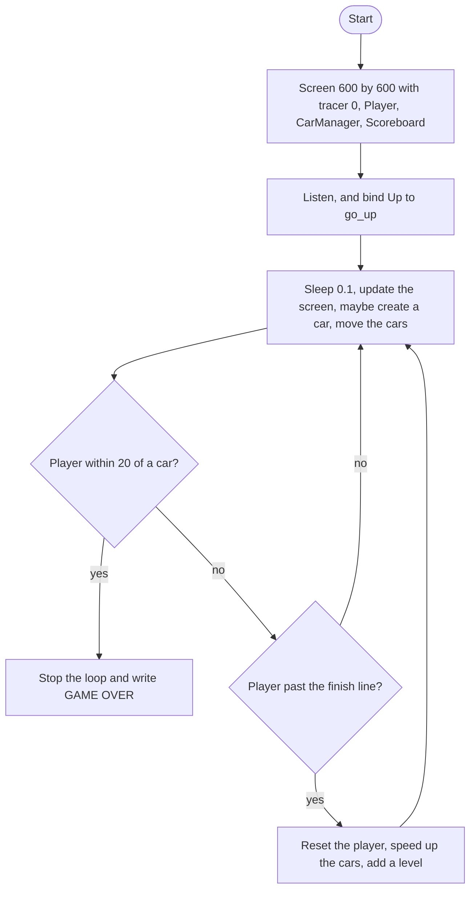

# Turtle Crossing Roadmap

Follow the stages in order. Finish and test one stage before you start the next, and only build what that stage asks for.

Before you write a change or check a result, say what you think will happen, then run it.

This program opens a turtle window for a crossing game. You steer a turtle north with the Up key, cars appear on the right and drive left, a hit ends the game, and a finished crossing resets the turtle, raises the level, and speeds the cars up.

Start from the files in this folder. You'll work in four files: `main.py`, `player.py`, `car_manager.py`, and `scoreboard.py`. The constants and the screen loop are already in place.

## The big picture

**One stage at a time:** write a stage, run it, and make sure it works before you touch the next one. If something breaks, it is almost always in the stage you just wrote.

## Stage 1: The screen
1. **Open `main.py`.** The screen is already 600 wide and 600 tall, animation is off with `tracer(0)`, and the loop sleeps 0.1 then calls `screen.update()`.
2. **Keep `screen.exitonclick()` at the bottom** so the window stays open.

Test it: Predict what happens, then run it. Do you get a blank 600 by 600 window that stays open until you click it?

## Stage 2: The player
1. **In `player.py`, run `super().__init__()` first** inside `Player.__init__`. The player itself is the turtle, so don't create a second turtle inside it.
2. **Give it the turtle shape, lift the pen, point it north, and send it to `STARTING_POSITION`.** A turtle shape starts facing east, so you have to set the heading. Use the constants already in the file.
3. **Fill in `go_up()`** so the player moves forward by `MOVE_DISTANCE`.
4. **In `main.py`, create a `Player` and bind `"Up"`** with `onkey` (or `onkeypress`). Pass the method name with no parentheses.
5. **The game loop is already there.** With tracer off, `screen.update()` is what actually draws the turtle.

Test it: Predict what happens, then run it. Does the turtle appear at the bottom without sliding in, and move 10 pixels north each time you press Up?

## Stage 3: The cars
1. **In `car_manager.py`, give `CarManager` a list for the cars** and a current speed that starts at `STARTING_MOVE_DISTANCE`. This class is a manager, not a turtle, so it does not inherit from `Turtle`.
2. **Fill in `create_car()`.** Only about 1 in 6 calls should actually build a car, or the road fills up in one second. You'll need `random` for that chance, for the color, and for the starting y.
3. **Each car is a square stretched to 20 tall by 40 wide.** A turtle starts 20 by 20. `shapesize` takes `stretch_wid` (up and down) and `stretch_len` (side to side). Which one needs to be 2?
4. **Lift the pen, pick a random color from `COLORS`, and start at the right edge** with a random y. Leave about 50 pixels clear at the top and bottom so cars don't spawn on the start or the finish. Append each new car to the list.
5. **Fill in `move_cars()`** so every car in the list moves left by the current speed.
6. **In `main.py`, create a `CarManager`.** Inside the loop, after the screen updates, call `create_car()` and `move_cars()`.

Test it: Predict what happens, then run it. Do cars appear on the right a few at a time, drive left, and stay off the very top and bottom?

## Stage 4: Collision
1. **After the cars move, loop through the car list.** If the player's distance to a car is less than 20, the turtle got hit.
2. **On a hit, set `game_is_on` to False** so the loop stops.

Test it: Predict what happens, then run it. If you walk the turtle into a car, does the game stop?

## Stage 5: The finish line
1. **Fill in `is_at_finish_line()`** so it returns True or False for "has the player's y gone past `FINISH_LINE_Y`?" Return the comparison itself.
2. **Fill in `go_to_start()`** so it sends the player back to `STARTING_POSITION`.
3. **Fill in `level_up()`** so the current car speed increases by `MOVE_INCREMENT`.
4. **In the loop, if the player has reached the finish line,** call `go_to_start()` and `level_up()`.

Test it: Predict what happens, then run it. When the turtle reaches the top, does it jump back to the bottom, and do the cars move faster on the next crossing?

## Stage 6: The scoreboard
1. **In `scoreboard.py`, run `super().__init__()` first.** Hide the turtle, lift the pen, and start the level at 1.
2. **Park it near the top left and write `Level: 1` using `FONT`.** Don't name the write method `update`, because Turtle already has that method.
3. **Fill in `update_scoreboard()`.** It clears, then writes the current level. Call it once from `__init__` after setup.
4. **Fill in `increase_level()`.** It adds 1 to the level and calls `update_scoreboard()`.
5. **Fill in `game_over()`.** It goes to the center and writes `GAME OVER` with the same font. Do not clear first, so the level stays visible.
6. **In `main.py`, create a `Scoreboard`.** A finished crossing calls `increase_level()`. A hit calls `game_over()`.

Test it: Predict what happens, then run it. Does the level start at 1, go up after a crossing, and does GAME OVER appear in the center when a car hits the turtle, with the level still showing?

## Stage 7: Break it on purpose
1. **Move `screen.tracer(0)` below the line that creates the Player.** Predict what happens, then run it. What do you see when the game starts, and why?
2. **Make `create_car()` build a car on every call, not about 1 in 6.** Predict what happens, then run it. What does the road look like after a couple of seconds?
3. **Rename `update_scoreboard` to `update`.** Predict what happens, then run it. What happens, and which class already owned that name?
