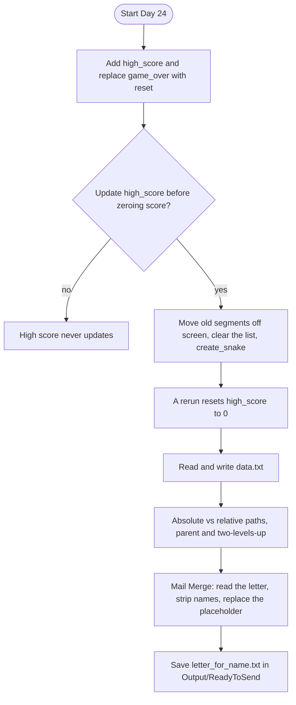

# Day 24 Roadmap

Follow the stages in order. Finish and test one stage before you start the next, and only build what that stage asks for.

Before you write a change or check a result, say what you think will happen, then run it.

Day 24 is about saving data in files and using file paths. You'll add a high score to Snake that survives a crash and a rerun, practice absolute vs relative paths, and automate a Mail Merge that writes one letter per invited name.

The Snake high-score project is in `snake-high-score/`. The Mail Merge project is in `mail-merge/`. The file-path demo from the lesson (the separate `day-24` project with `my_file.txt`) is not in this folder.

`mail-merge/Input/Letters/starting_letter.txt` and `mail-merge/Input/Names/invited_names.txt` are the official course starting files from the Mail Merge Project Start zip. `Output/ReadyToSend/` has only the official `example.txt`; run `main.py` to generate the rest of the letters. Do not move any of these files by hand.

## The big picture

**One stage at a time:** write a stage, run it, and make sure it works before you touch the next one. If something breaks, it is almost always in the stage you just wrote.

## Stage 1: A high score that resets the game

Work in `snake-high-score/`.

1. **On the scoreboard, add `self.high_score`.** `update()` should write both the score and the high score, and `self.clear()` should live inside `update()` so every refresh wipes the old text. You couldn't clear there before, because game over needed the score to stay on the screen.
2. **Replace `game_over()` with `reset()`.** If the current score is greater than the high score, update the high score first, then set the score to 0, then call `update()`. What happens if you zero the score first?
3. **Give Snake a `reset()` too.** Loop through the segments and send each one to `(1000, 1000)` so it leaves the 600 by 600 screen, then clear the list, call `create_snake()`, and set the head to the first segment again. Why do the turtles have to move off screen before you clear the list?
4. **In `main.py`, on a wall hit or a tail hit,** call `scoreboard.reset()` and `snake.reset()` instead of setting `game_is_on` to False or calling `game_over()`.

Test it: Predict what happens, then run it. After a crash, does the snake start over, does the high score stay on the screen, and does a new run beat that high score only when the score is actually higher?

## Stage 2: Save the high score in data.txt

Stopping and rerunning the program still resets the high score to 0, because variables don't remember state between runs.

1. **Create `data.txt` in the Snake folder with just `0` in it.**
2. **In `Scoreboard.__init__`, replace `self.high_score = 0`.** Open `data.txt` with `with open(...)`, read it, and save `int(data.read())` on `self` as the high score. `read()` gives a string, so you need `int()` to compare and increase it.
3. **Inside `reset()`, right after you set a new high score,** open `data.txt` again in `"w"` mode and write the high score as a string (an f-string works). You must use `"w"`, or the file won't let you write.

Test it: Predict what happens, then run it. Get a high score, stop the program, and run it again. Does the old high score still show, and did `data.txt` update? A `KeyboardInterrupt` in the console is just from clicking stop, not a bug.

## Stage 3: File paths

Files have a name and a path (directions to get to them). Folders can nest. An absolute path always starts from the root (`/` on a Mac, usually `C:` on Windows). A relative path starts from the working directory, which for these projects is the folder that holds `main.py`.

- `./` means the current folder, and you can drop it: `open("data.txt")` works when the file sits next to `main.py`.
- `../` goes up one folder to the parent. `../../` goes up two.
- Windows shows `\` between folders and Mac shows `/`, but in Python you can just write `/`.
- From the lesson's `day-24` project folder, a file on the Desktop is `"../../Desktop/my_file.txt"`. Moving a file without updating the path gives `FileNotFoundError`.

The path demo code itself is not in this upload. Use these ideas in the Mail Merge paths below.

Test it: Before you open a nested file, say whether the path is absolute or relative, and which folder it starts from.

## Stage 4: Mail Merge

Work in `mail-merge/`. Don't drag or drop any of the starting files. `starting_letter.txt` is inside `Input/Letters/`. The names are in `Input/Names/invited_names.txt`. Finished letters go in `Output/ReadyToSend/` as `letter_for_<name>.txt`. Look at `example.txt` for the final shape: the name, then a comma, with no extra space.

1. **Open `./Input/Letters/starting_letter.txt` and read the whole letter into a variable.** Which method gives you the entire file as one string: `read()`, `readline()`, or `readlines()`?
2. **Open `./Input/Names/invited_names.txt` and get the names as a list.** `readlines()` gives you each line, but only the first time you call it. If you call it again on the same open file, you get `[]`, because the file has already been read to the end. Save the list once, then loop over the variable. Close the file when you're done, or use `with open(...)`.
3. **Each name has a newline (`\n`) stuck to the end.** Use the string method that strips extra spaces and newlines off the ends.
4. **In each pass, replace the `[name]` placeholder** in a fresh copy of the letter with the clean name. Leave the original letter alone so the next name still has a placeholder to swap.
5. **Write each new letter** with `open(f"./Output/ReadyToSend/letter_for_{clean_name}.txt", mode="w")`. `"w"` creates the file if it doesn't exist. The file's name goes inside the path string in `open(...)`. The word after `as` is just a nickname for the open file, like `file`.

Test it: Predict what happens, then run it. Open one letter in `Output/ReadyToSend/`. Does it match the example, with the right name and no extra space before the comma?

## Stage 5: Break it on purpose

1. **In `reset()`, set `self.score = 0` before you compare it to the high score.** Predict what happens, then run it. Does a new best score ever get saved, and why?
2. **In Mail Merge, call `readlines()` a second time and loop over that second call.** Predict what happens, then run it. How many letters get written?
3. **Open `data.txt` to read the high score, but use `mode="w"`. ** Predict what happens, then run it. What do you get back from `read()`, and what happened to the number that was in the file?
