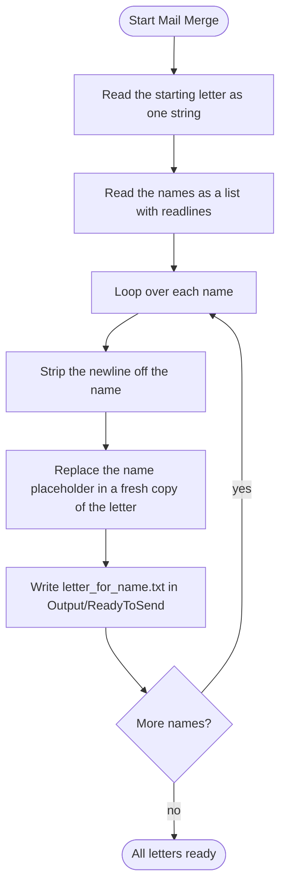

# Day 24 Roadmap: Mail Merge

Follow the stages in order. Finish and test one stage before you start the next, and only build what that stage asks for.

Before you write a change or check a result, say what you think will happen, then run it.

The project is in `mail-merge/`. It writes one invitation letter per invited name, so you don't have to type each one by hand.

`Input/Letters/starting_letter.txt` and `Input/Names/invited_names.txt` are the official course starting files. Finished letters go in `Output/ReadyToSend/` as `letter_for_<name>.txt`, next to the official `example.txt`. Don't drag or drop any of the starting files.

## The big picture

**One stage at a time:** write a stage, run it, and make sure it works before you touch the next one. If something breaks, it is almost always in the stage you just wrote.

## Stage 1: Read the starting letter

Open `./Input/Letters/starting_letter.txt` with `with open(...)` and read the whole letter into a variable. Which method gives you the entire file as one string: `read()`, `readline()`, or `readlines()`?

Test it: Predict what prints, then print the variable. Do you see the whole letter, including `[name]`?

## Stage 2: Read the names

Open `./Input/Names/invited_names.txt` and get the names as a list with `readlines()`. It only works the first time; a second call on the same open file gives `[]`, because the file has already been read to the end. Save the list once in a variable.

Test it: Predict what prints, then print the list. What is stuck to the end of every name except the last?

## Stage 3: Clean each name

Loop over the list. Each name has a newline (`\n`) on the end. Use the string method that strips extra spaces and newlines off the ends, and save the clean name.

Test it: Print each clean name. Is the extra blank line gone?

## Stage 4: Swap in the name

In each pass, replace the `[name]` placeholder with the clean name. `replace()` gives back a new string, so save it in a new variable and leave the original letter alone, so the next name still has a placeholder to swap. A constant like `PLACEHOLDER = "[name]"` at the top works too.

Test it: Print one new letter. Does it say `Dear Aang,` with no extra space or line before the comma?

## Stage 5: Write the letters

Write each new letter with `open(f"./Output/ReadyToSend/letter_for_{clean_name}.txt", mode="w")`. `"w"` creates the file if it doesn't exist. The file's name goes inside the path string in `open(...)`. The word after `as` is just a nickname for the open file.

Test it: Predict how many files you'll get, then run it. Open one letter in `Output/ReadyToSend/`. Does it match `example.txt`?

## Stage 6: Break it on purpose

1. **Call `readlines()` a second time and loop over that second call.** Predict what happens, then run it. How many letters get written?
2. **Skip the strip and use the raw name in `replace()`.** Predict what happens, then run it. What does the greeting line look like?
3. **Save the replaced letter back into the original letter variable.** Predict what happens, then run it. What name is in every letter after the first?
