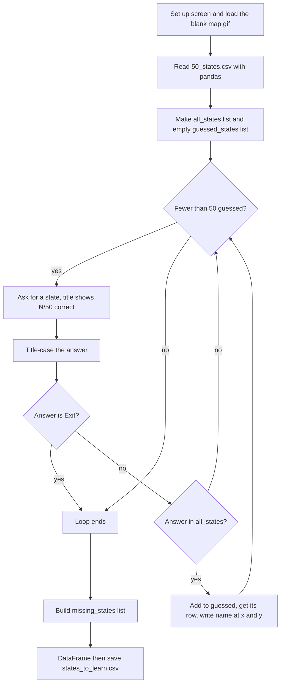

# Day 25 Roadmap: US States Game

## Steps
1. Screen, title, and the blank map as a turtle shape (only .gif works).
2. Read the CSV, get the states as a list, and start an empty guessed list.
3. Loop: ask, title-case, check for Exit, check if it's a real state.
4. Correct guess: get the row, use .item() for x and y, write the name there.
5. After the loop: collect the missing states and save them to states_to_learn.csv.
