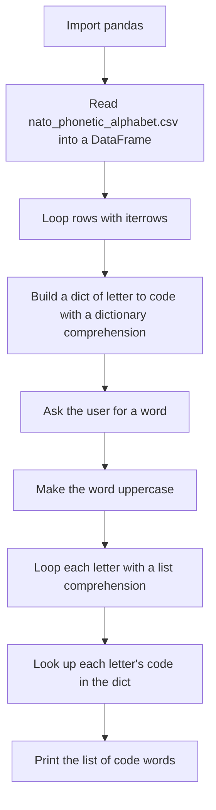

# Day 26 Roadmap: NATO Phonetic Alphabet

## Steps
1. Read the CSV with pandas.
2. Build the letter-to-code dictionary with a dictionary comprehension over iterrows().
3. Ask for a word and uppercase it so it matches the keys.
4. Build the list of code words with a list comprehension.
5. Print the list.
