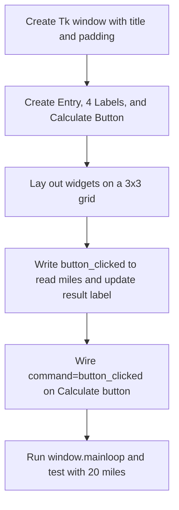

# Day 27 — Miles to Kilometer Converter Roadmap

## Stages
1. **Window setup:** `Tk()`, `.title(...)`, `.config(padx=20, pady=20)`, and `window.mainloop()` at the bottom.
2. **Widgets:** `Entry(width=7)`, four `Label`s (`"Miles"`, `"is equal to"`, `"0"`, `"Km"`), and `Button(text="Calculate")`.
3. **3x3 Grid layout:** place each widget with `.grid(column=..., row=...)`.
4. **Conversion function:** read `miles_input.get()`, convert with `float(...) * 1.609`, round, and update `result_label.config(text=...)`.
5. **Wire & test:** pass `command=button_clicked` (no parentheses) to the button and test with `20` miles -> `32` km.
