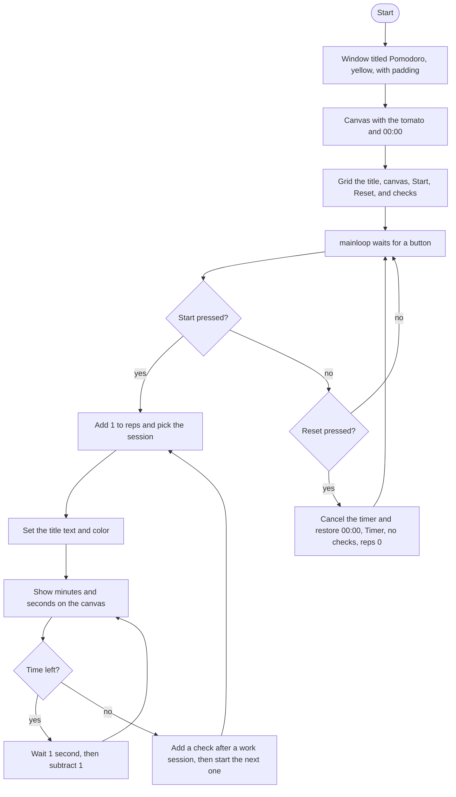

# Day 28 Roadmap: Pomodoro Timer

Follow the stages in order. Finish and test one stage before you start the next, and only build what that stage asks for.

Before you write a change or check a result, say what you think will happen, then run it.

This program opens a window with a tomato. Start counts down a work session, then a short break. After four work sessions, the next break is long. Each finished work session adds a check mark. Reset stops the countdown and puts the screen back to the start.

`tomato.png` and `main.py` are in this folder. The color constants (`PINK`, `RED`, `GREEN`, `YELLOW`), `FONT_NAME` (`"Courier"`), and the minute constants (`WORK_MIN`, `SHORT_BREAK_MIN`, `LONG_BREAK_MIN`) belong at the top. The comment banners are the homes for the rest: `CONSTANTS`, `TIMER RESET`, `TIMER MECHANISM`, `COUNTDOWN MECHANISM`, and `UI SETUP`.

## The big picture

**One stage at a time:** write a stage, run it, and make sure it works before you touch the next one. If something breaks, it is almost always in the stage you just wrote.

## Stage 1: The window

1. **Open a Tk window.** The lesson imports tkinter with a star import. Which call builds the window, and which call at the bottom keeps checking for events so the window stays open?
2. **Title it Pomodoro.**
3. **Add padding** with `config`. Which keyword is the horizontal padding, and which is the vertical one? This window uses 100 and 50.
4. **Color the background yellow.** `bg` means background. The hex codes already live in constants. Do you put quotes around the constant, or pass the name itself?

Test it: Predict what you see, then run it. Is the window titled Pomodoro, yellow, with empty space around the middle, and does it stay open?

## Stage 2: The tomato and the time

1. **Add a Canvas in `UI SETUP`.** `tomato.png` is 200 by 223. Size the canvas to the picture. The finished window uses 200 wide and 224 tall. Give the canvas the same yellow background as the window. `width`, `height`, and `bg` are normal widget options.
2. **Load the picture with `PhotoImage`.** `file` belongs to `PhotoImage`, and the path is relative to `main.py`. What goes wrong if you hand `create_image` the filename string itself?
3. **Center the image.** `create_image` takes x and y first. What is half the canvas width, and half the canvas height?
4. **Remove the white border.** The option is one word, with two t's and no underscore, set to 0. Taking the border off shifts the picture. The lesson moved x back to 100. If a side looks cut off, nudge x by eye.
5. **Write `00:00` on the red part** with `create_text`. x and y come first. The rest are keywords: the text, a white fill, and the font. The font is a tuple of name, size, and style, using `FONT_NAME`, 35, and bold. The lesson centered that text at y 130. Keep what `create_text` returns. You will change this text later, and a canvas does not use `config` for that.
6. **Show the canvas** with `pack()` for this stage only.

Test it: Predict what you see, then run it. Is the tomato centered, is `00:00` sitting on the red, is the white frame gone, and does the yellow of the canvas blend into the window?

## Stage 3: Title, buttons, and the check

1. **Switch the canvas to `grid`.** This layout is about 4 rows by 3 columns. The middle column is column 1. What error do you get if one widget still uses `pack`?
2. **Title label on row 0, column 1,** with the text Timer. `fg` is the text color and `bg` is the background. Which one turns the word green, and which one blends the label into the window? The font tuple uses `FONT_NAME` and size 50.
3. **Canvas on row 1, column 1.**
4. **Start on row 2, column 0. Reset on row 2, column 2.** Use the same border option as the canvas, set to 0, so the buttons lose their white frame.
5. **A check mark label on row 3, column 1.** Paste a ✔ as its text for now, so you can see it. Green text, yellow background.

Test it: Predict the layout, then run it. Is Timer on top, the tomato under it, Start on the left, Reset on the right, and a green check underneath? Are the white borders gone?

## Stage 4: Count down

1. **Leave `while` and `time.sleep` out of this.** Tkinter is event-driven. `mainloop` is what keeps checking for events. A loop that never ends means `mainloop` never starts. What happens to the window?
2. **`window.after` waits, then calls a function.** The first argument is milliseconds. How many milliseconds are one second? Anything you pass after the function name is handed to that function.
3. **Write `count_down(count)` under `COUNTDOWN MECHANISM`.** It should schedule itself one count smaller. With no check, the numbers keep going below 0. What comparison stops the scheduling when the count is used up?
4. **Update the canvas text** with `itemconfig` on the text you saved in Stage 2. Pass the count variable. What appears if you pass the word count in quotes instead?
5. **Call `count_down` only after the canvas exists.** What error do you get if the call runs first?
6. **Write `start_timer` under `TIMER MECHANISM`** so it starts `count_down` at 5. Hook it to the Start button with `command`. Do you put parentheses after the function name?
7. **Then count minutes.** How many seconds are in a minute? A 5 minute countdown is that many times 5. Split the count with `math.floor` for the minutes and `%` for the leftover seconds. `floor` gives the largest whole number that is still less than or equal to the value, so 4.8 becomes 4. What is `245 % 60`, and what is `100 % 60`?
8. **Show both numbers** on the canvas as minutes, a colon, and seconds.

Test it: Predict, then press Start on a 5 second countdown. Do you see 5, then 4, 3, 2, 1, and does it stop at 0? Can you still drag the window while it counts? Start a 5 minute countdown next. The first text looks like 5:0. That short zero is the next stage.

## Stage 5: Two digits

1. **A whole minute shows one zero** because the leftover seconds are the number 0, and the canvas prints that number.
2. **One patch:** when the seconds equal 0, store the text `00` instead. You checked a number, then assigned a string. A Python variable can hold a new type on the next assignment. What is that called?
3. **Each value still has a fixed type.** What error do you get if you add a number and a string? C, Java, and Swift keep one type on a variable for its whole life. Python is strongly typed and dynamically typed.
4. **The zero patch misses 9, 8, 7, and the rest under 10.** What comparison catches every seconds value that needs a leading 0, including 0? Check it while it is still a number, then build the two-character text with an f-string.

Test it: Predict the text, then start a 5 minute countdown. Does it open at 5:00? Start a 10 second countdown. Do the last seconds read 09, 08, and 07?

## Stage 6: Work and breaks

1. **Turn the three minute constants into seconds.** What do you multiply by? Work is `WORK_MIN`, the short break is `SHORT_BREAK_MIN`, and the long break is `LONG_BREAK_MIN`.
2. **Keep `reps` at 0** up with the constants. `start_timer` adds 1 each time it runs. What keyword lets a function change a name that lives outside the function?
3. **Pick the countdown from the rep.** Reps 1, 3, 5, and 7 are work. Reps 2, 4, and 6 are the short break. Rep 8 is the long break. Rep 8 is also even, so one of the tests matches it too early. Which check has to come first?
4. **Change the title for that session** with `config` on the title label. Work: text Work, green. Short break: text Break, pink. Long break: text Break, red. Use the color constants.
5. **A countdown that reaches 0 currently just sits there.** The button is the only thing calling `start_timer`. In the branch where the count is used up, call `start_timer` again so the next session starts on its own.
6. **To watch a session finish, set `WORK_MIN` to 1.** Leave it there until Stage 8.

Test it: Predict the order, then press Start. Is the title Work in green? When the minute hits 0, does the next countdown start without another click, with the title Break in pink? Rep 8 is the red long break. Which comparison catches a rep divisible by 8 before the even-rep test?

## Stage 7: Check marks

1. **Start the check label empty.** Stage 3 pasted a ✔ so you could see the label. The real text is an empty string.
2. **One check is one finished work session.** How many reps make one work session?
3. **When the count hits 0, start the next session first, then rebuild the checks.** Dividing reps by 2 gives a float, and `range` needs a whole number. Which `math` function do you already use to chop off the fraction? Build a string with that many ✔ characters and set it as the label text.

Test it: Predict, then run it with work still at 1 minute. When the first work session hits 0, does one ✔ appear, and does the title switch to Break? A break ending does not add another check. The next ✔ waits until the next work session finishes.

## Stage 8: Reset

1. **Write `reset_timer` under `TIMER RESET`** and hook it to the Reset button the same way Start is hooked. Parentheses or not?
2. **Stop the running countdown.** `after` gives back an id. Save that id in a name that starts as `None` up with `reps`. `count_down` has to use `global` when it stores the new id. What do you pass to `after_cancel`?
3. **Put the screen back** to how Stage 7 left it at the start: canvas text `00:00`, title text Timer, check marks empty.
4. **Set `reps` back to 0** in `reset_timer`, with `global` so the assignment sticks. Reset in the middle of a session, then press Start. If `reps` is still climbing, which session comes up instead of Work?
5. **Put the real minutes back:** work 25, short break 5, long break 20.

Test it: Predict, then start a countdown and press Reset halfway through. Does the time return to 00:00, the title to Timer, and the checks to empty? Press Start again. Is the title Work in green? After that, are the three minute constants 25, 5, and 20?

## Stage 9: Break it on purpose

Put the program back after each try.

1. **Count with `while` and `time.sleep` instead of `after`.** Predict, then run it. Does the window open?
2. **Remove the check that stops the countdown at 0.** Predict, then run it. What does the time do after 0?
3. **Call `count_down` before the canvas exists.** Predict, then run it. What error do you get?
4. **Skip the leading 0 on the seconds.** Predict, then run it. What does a whole minute look like, and what do the last nine seconds look like?
5. **Do not call `start_timer` when the count hits 0.** Predict, then run it. What happens at 0?
6. **Mix `pack` and `grid` on purpose.** Predict, then run it. What error do you get?
7. **Reset without setting `reps` back to 0.** Predict, then run it. After Reset and Start, which session comes up?
