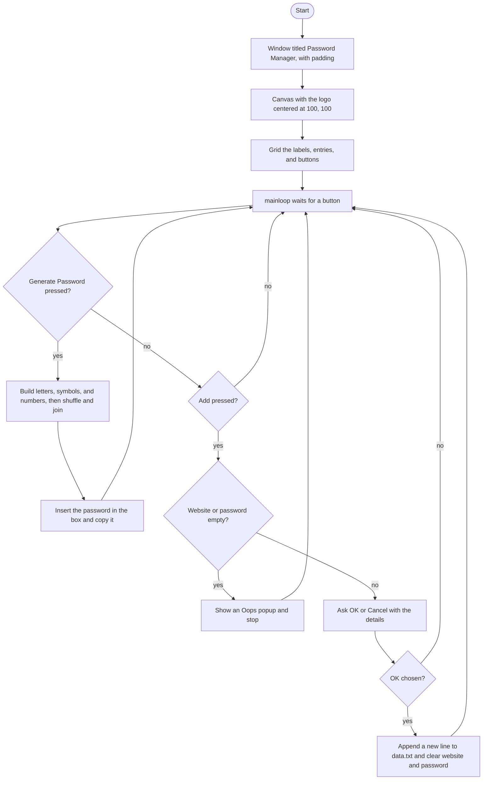

# Day 29 Roadmap: Password Manager

Follow the stages in order. Finish and test one stage before you start the next, and only build what that stage asks for.

Before you write a change or check a result, say what you think will happen, then run it.

This program opens a window with a logo. You type a website, use a pre-filled email, and either type a password or generate a strong one. Generate Password also copies it to the clipboard so you can paste it into a signup form. Add asks you to confirm the details, blocks empty website or password fields, and appends a new line to data.txt.

`logo.png` and `main.py` are in this folder. The comment banners are the homes for the rest: `PASSWORD GENERATOR`, `SAVE PASSWORD`, and `UI SETUP`.

## The big picture

**One stage at a time:** write a stage, run it, and make sure it works before you touch the next one. If something breaks, it is almost always in the stage you just wrote.

## Stage 1: The window

1. **Open a Tk window.** The lesson imports tkinter with a star import. Which call builds the window, and which call at the bottom keeps checking for events so the window stays open?
2. **Title it Password Manager.**
3. **Add padding** with `config`. Which keyword is the horizontal padding, and which is the vertical one? This window uses 20 and 20.

Test it: Predict what you see, then run it. Is the window titled Password Manager, with empty space around the middle, and does it stay open?

## Stage 2: The logo

1. **Add a Canvas in `UI SETUP`.** Size it 200 wide and 200 tall, about the size of `logo.png`.
2. **Load the picture with `PhotoImage`.** `file` belongs to `PhotoImage`, and the path is relative to `main.py`. What goes wrong if you hand `create_image` the filename string itself?
3. **Center the image.** `create_image` takes x and y first. What is half of 200? What error do you get if you skip those two numbers and only pass the image?
4. **Show the canvas** with `pack()` for this stage only.

Test it: Predict what you see, then run it. Is the logo centered on a 200 by 200 canvas, with 20 pixels of space on all four sides?

## Stage 3: Labels, entries, and buttons

1. **Switch the canvas to `grid`.** This layout is about 5 rows by 3 columns. The middle column is column 1, and the canvas goes on the top row. What error do you get if one widget still uses `pack`?
2. **Three labels down column 0:** Website: on row 1, Email/Username: on row 2, Password: on row 3.
3. **Website and email boxes** go in column 1 on those same rows. They should stretch across the right side of the window. Doubling a widget's width only makes its own column wider. Which grid option lets a widget cover two columns, and what width did the lesson use for those two boxes?
4. **The password box** stays in one column (the lesson used width 21) so there is room beside it.
5. **Generate Password** sits in the same row as the password box, in the last column.
6. **Add** goes on the bottom row and spans two columns. The lesson used width 36. Which column does it start in, and what is its columnspan?

Test it: Predict the layout, then run it. Is the logo on top in the middle? Do the website and email boxes line up all the way across, while the password box leaves room for Generate Password? Is Add a wide button on the bottom row?

## Stage 4: Cursor and default email

1. **Put the cursor in the website box** when the app launches so you can start typing right away. Which Entry method does that?
2. **Pre-fill the email box** with a default email. `insert` takes an index and a string. What index puts the text at the very start? What Tkinter constant would insert it after text that is already in the box?

Test it: Predict, then run it. Does the cursor start in the website box? Is the email already filled in, and can you still edit it?

## Stage 5: Save to the file

1. **Write `save` under `SAVE PASSWORD`** and hook it to the Add button with `command`. Do you put parentheses after the function name?
2. **Read the text** from all three entries. Which method fetches the current text? What ends up in data.txt if you assign the Entry widget itself instead of calling that method?
3. **Open data.txt in append mode** with `with open`. Why `with`? What is the difference between `"a"`, `"w"`, and `"r"`? If the file does not exist yet, do append or write mode create it?
4. **Write one row** as an f-string: the website, a space, a pipe, a space, the email, a space, a pipe, a space, the password. The method on a file is `write`, not `append`. `append` belongs to lists. What error do you get if you call `append` on the file?
5. **End the string with `\n`.** What happens to the next saved row if you leave that off?
6. **Clear the website and password boxes** after a successful write, and leave the email alone. `delete` takes a first and last index. What happens if you only pass the starting index?

Test it: Predict, then type a website and a password and press Add. Does data.txt appear, with that row in it? Are the website and password boxes empty, and is the email still there? Save a second row. Does it start on its own new line?

## Stage 6: Confirm with a popup

1. **Import messagebox.** You already imported tkinter with a star. Why is that not enough? `messagebox` is not a class. What extra import do you need?
2. **Before you write to the file,** ask the user if the details look right. `askokcancel` needs a title and a message. A good title is the website they typed. The message can be an f-string with the email, the password, and a question: is it ok to save?
3. **`askokcancel` gives back a boolean.** Store it as `is_ok`. If it is True, write to the file and clear the boxes. If they choose Cancel, what should the function do?

Test it: Predict, then press Add with a website and password filled in. Do you get a popup that shows the email and password? If you choose Cancel, does data.txt stay unchanged and do the boxes keep their text? If you choose OK, does the row get saved and do the website and password boxes clear?

## Stage 7: Block empty fields

1. **After you read the entries, check their length.** If the website has length 0, or the password has length 0, show an info popup. The lesson used the title Oops and a message asking the user not to leave fields empty.
2. **Why skip the email in this check?**
3. **Put the confirm-and-save code in the `else`** so it only runs when both of those fields have text.

Test it: Predict, then press Add with the website empty, then with the password empty, then with both empty. Do you get the Oops popup each time, and does data.txt stay unchanged? Fill both in, press Add, and confirm. Does the save still work?

## Stage 8: Generate a password

1. **Drop the starter generator** into `PASSWORD GENERATOR`. It picks 8 to 10 letters, 2 to 4 symbols, and 2 to 4 numbers. Put `import random` at the top. You can also import just `choice`, `randint`, and `shuffle` if you want to drop the `random.` prefix.
2. **Rewrite the three for-loops as three list comprehensions.** The shape is `[new_item for _ in range(...)]`. What should `new_item` be so you get letters, not the counter numbers 0, 1, 2...? Why use `_`?
3. **Add the three lists together** into one `password_list`, then shuffle that list.
4. **Turn the list into one string.** `join` is a string method. What is the glue if you call it on an empty string?
5. **Wrap it in `generate_password`** and hook it to the Generate Password button with `command`. Parentheses or not? Give the button its own name. What goes wrong if the button variable is also called `generate_password`?
6. **Put the password in the password box** with `insert`, the same way you pre-filled the email. Which index puts it at the start? Why not `print` the password?

Test it: Predict, then press Generate Password. Does a mixed string of letters, symbols, and numbers appear in the password box? Press it again. Do you get a different password?

## Stage 9: Copy to the clipboard

1. **Install pyperclip** once in the terminal: `python -m pip install pyperclip`. Then `import pyperclip` at the top of `main.py`.
2. **After you generate the password,** copy it. Which pyperclip method takes the text to put on the clipboard? The other method, `paste`, would read whatever is already there.

Test it: Predict, then press Generate Password and paste into another field or a text file. Is it the same password you see in the box?

## Stage 10: Break it on purpose

Put the program back after each try.

1. **Call `create_image` with only the image,** and skip x and y. Predict, then run it. What error do you get?
2. **Mix `pack` and `grid` on purpose.** Predict, then run it. What error do you get?
3. **Assign the Entry widget itself** instead of calling `.get()`. Predict, then save. What shows up in data.txt?
4. **Call `append` on the file** instead of `write`. Predict, then run it. What error do you get?
5. **Leave `\n` off the write.** Predict, then save two entries. Where does the second row go?
6. **Call `delete` with only one index.** Predict, then save. How much of the box clears?
7. **Skip the messagebox import** and call `messagebox.askokcancel` anyway. Predict, then run it. What error do you get?
8. **Use `[int for int in range(random.randint(8, 10))]`** for the letters. Predict, then generate a password. What kind of "password" do you get?
9. **Name the button `generate_password`** with `command=generate_password`. Predict, then press the button. What goes wrong?
