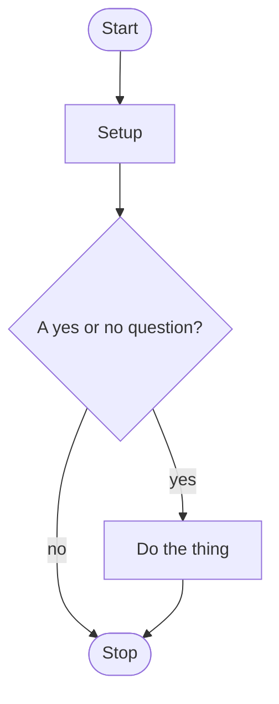

# 🏀 Project Gameplan: My Spots

> Get to your spots. Efficient, not fancy. Same moves, every project.

### 1. See the shot
Picture the end result. What should the finished program look like?

### 2. Draw up the play
Write a step-by-step `# TODO` checklist for the program, then fill in the roadmap skeleton below.

### 3. One possession at a time
Do one TODO at a time. Run the program after every step, no matter how simple. Once it works, "hide" that step: mark its `# TODO` comment line as done. The code itself stays in and keeps running. Then move to the next one.

### 4. Missed shot? Watch the film
Got an error? Go back to that step and trace it yourself first. Still stuck? Bring Practice Coach the steps done so far. Hints only, **never** the answer.

### 5. Clean up the game
When the code is done, put any repeated code into a function and simplify the rest.

### 6. Practice tomorrow
Practice Coach logs every spot I got stuck on and turns it into flashcards, a pop quiz, and read-and-fix rounds for the next day. Next day: do a rebuild, and watch Bro Code or another YouTuber on the parts I missed, before moving to the next course day.

---

**Side rule:** Name every variable so it's easy to understand at a glance.

**Side rule:** Add a docstring to every function I create so I know what it's for.

```python
def process_coins():
    """Ask for coins and return the total in dollars."""
```

---

## Roadmap skeleton

Copy this into a `{project}-roadmap.md` file next to the project's code. Follow the stages in order. Finish and test one stage before you start the next, and only build what that stage asks for.

~~~~markdown
# [Project] Roadmap

Follow the stages in order. Finish and test one stage before you start the next, and only build what that stage asks for.

## The big picture



**One stage at a time:** write a stage, run it, and make sure it works before you touch the next one. If something breaks, it is almost always in the stage you just wrote.

## Stage 1: [short name]
1. **A nudge as a question.** What tool does this? Where does it live? Don't paste the full solution.
2. **Another small step.**

Test it: how will I know this stage works?

## Stage 2: [the next small piece]
...

## Stage N: Tidy up and break it
1. **Remove repeated code** if you wrote the same lines more than once.
2. **Break it on purpose.** Try a typo, a blank answer, or a capital letter. What happens?
3. **Explain it out loud.** Can you say what every line does without peeking?
~~~~

**Flowchart rules**
- Start with a rounded box that says Start, and end with one that says Stop.
- Every action is a rectangle. Every yes/no question is a diamond, with a labeled arrow for each answer.
- Anything that repeats gets an arrow that loops back up to the question.
- Put quotation marks around a label that has a question mark, like `{"Play again?"}`.
- Don't use these as a box's short name: `click`, `end`, `call`, or `direction`. Those words break the picture on GitHub.

**Stage rules**
- One stage at a time. Run and test it before you start the next.
- Steps are questions and nudges, not a pasted solution.
- If something breaks, look in the stage you just wrote first.
- Stuck for 5 minutes? Write down the exact question and ask Practice Coach for a hint.
