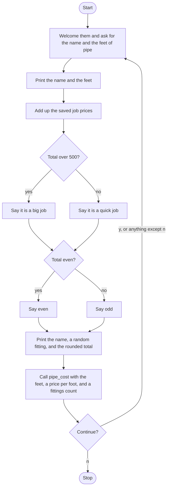

# Plumbing Job Estimator Roadmap

Follow the stages in order. Finish and test one stage before you start the next, and only build what that stage asks for.

## The big picture

**One stage at a time:** write a stage, run it, and make sure it works before you touch the next one. If something breaks, it is almost always in the stage you just wrote.

## Stage 1: Name and pipe
1. **A flag starts true,** and a loop runs while it is true.
2. **Each pass resets its own job total to 0** at the top of the loop. Why would leaving last job's total in place matter?
3. **Welcome them, ask for the customer's name, and ask how many feet of pipe** the job needs. The feet are a whole number.
4. **Print the name, then print the feet,** each on its own line.

Test it: enter a name and 10. Do both print back before anything else?

## Stage 2: Add the saved prices
1. **The saved prices are a list** that does not change from job to job. The feet of pipe are not part of this total.
2. **Add every price into the job total** with a loop. Start from the 0 you set at the top of the pass.
3. **Print the total** after the loop, not on every price.

Test it: add the list by hand. Does the printed total match, and is it the same number on a second job?

## Stage 3: Big or quick, even or odd
1. **Over 500 is a big job.** Anything else, including exactly 500, is a quick job. Which comparison matches that?
2. **Then say whether the total is even.** Which operator gives a remainder, and what remainder means even?
3. **These two checks are about the saved-price total,** not about the pipe cost in the next stage.

Test it: with the prices in this file, which label prints, big or quick? Even or odd? Check it by hand before you trust the output.

## Stage 4: A random fitting and the rounded total
1. **Import random,** and keep a list of fitting names.
2. **Pick one fitting each pass,** before you print. Which function picks one item from a list?
3. **Print one line** with the customer's name, that fitting, and the job total rounded to 2 decimal places. This line uses the saved-price total, not the pipe cost.

Test it: run it twice. Does the fitting change, while the rounded total stays the same?

## Stage 5: pipe_cost
1. **Define `pipe_cost(length_feet, price_per_foot, fittings)`** with a docstring.
2. **It prints** the length times the price per foot, plus 4 times the fittings count. It does not return that number.
3. **Call it with keyword arguments:** the feet they typed, a price per foot of 4, and a fittings count of 6. The fittings count is not the random fitting name. Those are two different things.

Test it: 10 feet of pipe. Does the pipe line print 64? Try 0 feet. Does it print 24?

## Stage 6: Another job
1. **After the pipe cost, ask** whether to continue, y or n, and make the answer lowercase.
2. **`y` leaves the flag true.** `n` sets it false. Any other answer also leaves it true, so the questions start again.
3. **A new pass** asks for a new name and a new length, picks a new fitting, and adds the saved prices up from 0 again.

Test it: estimate two jobs, saying `y` between them, then `n`. Does the second job ask for a new name? Does `n` stop?

## Stage 7: Tidy up and break it
1. **Break it on purpose.** Feet as a word? Continue answer `Y`? Continue answer `yes`?
2. **Explain it out loud.** Which total is the sum of the saved prices, and which number is the pipe cost? Why is the random fitting not an input to `pipe_cost`?
